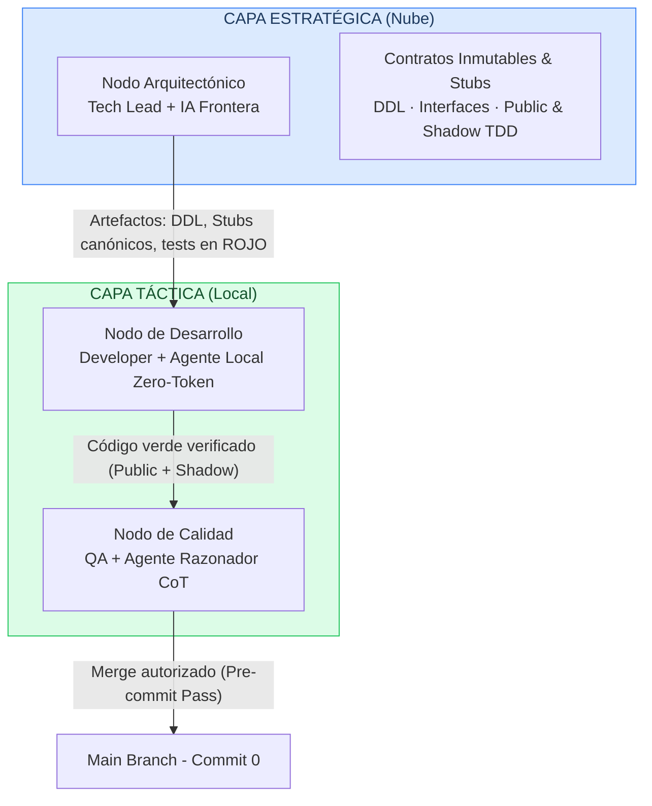
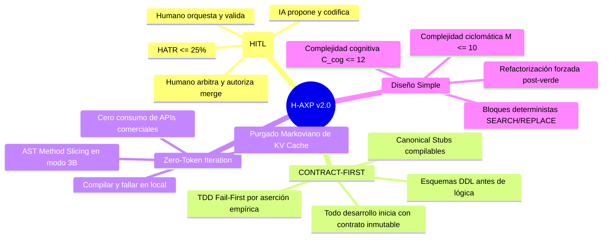
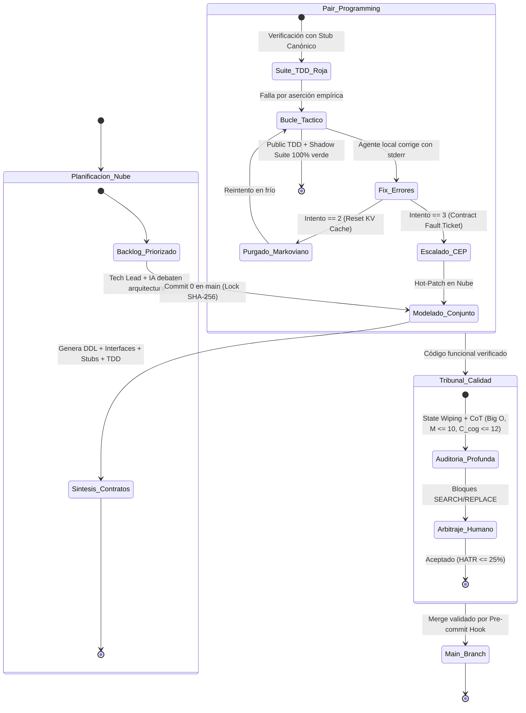

# Hybrid-Agentics eXtreme Programming (H-AXP)

> **Autor:** Bruno Guzmán, Estudiante de Ing. Informatica en la UNA · Asunción, Paraguay
> **Categoría:** Metodología Ágil, Inteligencia Artificial, Ingeniería de Software, Desarrollo de Software.

[](LICENSE)
[](#)
[](#)

---

## ¿Qué es H-AXP?

**H-AXP (v2.0)** es un marco de desarrollo de software híbrido y simbiótico que sintetiza la gobernanza de **SCRUM** con el rigor de **eXtreme Programming (XP)**, estructurando el trabajo en torno a "Equipos H-AXP": binomios **Humano + Agente de IA** que operan como unidades de producción cohesionadas.

La metodología responde a cuatro problemas críticos del desarrollo asistido por IA:

| Problema | Descripción | Mitigación H-AXP v2.0 |
|---|---|---|
| 🌀 **Vibe Coding** | Delegación desestructurada que produce prototipos frágiles sin contratos | **CONTRACT-FIRST** inmutable y desarrollo dirigido por pruebas (TDD) |
| 🏚️ **Deriva Arquitectónica** | Los LLMs mutan interfaces para resolver fallos locales de compilación | Candado criptográfico SHA-256 de contratos ($CMR = 0.0\%$) |
| 💸 **Costo de Inferencia** | El uso irrestricto de APIs comerciales en el bucle de compilación genera costos inviables | **Zero-Token Iteration** en hardware local ($0$ tokens comerciales en bucle de código) |
| 🪤 **Reward Hacking** | Modelos locales sobreajustan el código con tablas de búsqueda condicionales | **Doble Anillo de Validación**: Property-Based Testing + Shadow Validation Suite |

---

## Arquitectura de Dos Capas



---

## Los Cuatro Axiomas (v2.0)



---

## Topología del Equipo (Nodos Simbióticos)

```mermaid
graph LR
    subgraph PRODUCTO["Nodo de Producto"]
        PO[Product Owner<br/>Scrum Manager]
        CLI[Cliente]
    end

    subgraph ARQUITECTURA["Nodo Arquitectónico"]
        TL[Tech Lead]
        IA_NUBE[IA Frontera<br/>Claude / GPT-4 / Gemini]
    end

    subgraph DESARROLLO["Nodo de Desarrollo"]
        DEV[Developer - Navegante]
        IA_LOCAL[Agente Local - Conductor<br/>Cursor / Copilot / Ollama]
    end

    subgraph CALIDAD["Nodo de Calidad"]
        QA[Revisor / QA - Árbitro]
        IA_RAZON[Agente Razonador<br/>CoT Local / DeepSeek]
    end

    PRODUCTO -->|"User Stories (Nivel 1 o 2) + Criterios"| ARQUITECTURA
    ARQUITECTURA -->|"Contratos + Stubs + Suites Roja & Sombra"| DESARROLLO
    DESARROLLO -->|"Código Verde generalizado"| CALIDAD
    CALIDAD -->|"Aprobación / Merge"| PRODUCTO

    style PRODUCTO fill:#fef9c3,stroke:#ca8a04
    style ARQUITECTURA fill:#dbeafe,stroke:#3b82f6
    style DESARROLLO fill:#dcfce7,stroke:#22c55e
    style CALIDAD fill:#fce7f3,stroke:#ec4899
```



---

## Ciclo de Vida: El Micro-Sprint (v2.0)

El Micro-Sprint reemplaza el sprint tradicional de 2–4 semanas por **iteraciones de 3 a 7 días**, estructuradas bajo Trunk-Based Development con Commit 0:



---

## Métricas de Rendimiento (v2.0)

| Métrica | Sigla | Formulación / Método | Umbral H-AXP v2.0 |
|---|---|---|---|
| **Densidad de Defectos** | DD | Defectos encontrados en *staging* / KLOC | ≤ 0.5 defectos / KLOC |
| **Tasa de Mutación de Contratos** | CMR | Porcentaje de PRs con mutación de interfaces | **0.0%** (Bloqueo absoluto) |
| **Ratio de Tests Locales** | LTPR | Suites resueltas puramente en runtime local | ≥ 85% de las pruebas |
| **Costo de Tokens por Feature** | $TCF_{total}$ | $\sum (T_{input} + T_{reasoning} + T_{output})$ en nube | $TCF_{I/O} \le 4.500$ ($TCF_{total} \le 12.000$) |
| **Complejidad Ciclomática** | $\mathcal{M}$ | Grafo de flujo de control $E - V + 2P$ (McCabe) | $\mathcal{M} \le 10$ por método |
| **Complejidad Cognitiva** | $\mathcal{C}_{cog}$ | Penalización incremental por nivel de anidamiento | $\mathcal{C}_{cog} \le 12$ por método |
| **Ratio de Arbitraje Humano** | HATR | Tiempo humano en arbitraje / tiempo total micro-sprint | $HATR \le 25\%$ |
| **Mutation Score de la Suite** | MS | Mutantes detectados y eliminados por la suite TDD | $MS \ge 85\%$ |

---

## Hipótesis Científica

> **H₀ (Nula):** La aplicación del ciclo H-AXP *no* genera variaciones estadísticamente significativas en la tasa de defectos, la estabilidad de contratos y el costo por funcionalidad en comparación con el desarrollo ágil tradicional asistido por chat no estructurado.

> **H₁ (Alternativa):** La segregación de responsabilidades en Nodos Simbióticos H-AXP, junto con el ciclo TDD Zero-Token, los Stubs Canónicos, las Shadow Suites y el micro-contexting, reduce la deuda técnica, elimina la mutación no autorizada de interfaces ($CMR = 0\%$) y reduce el costo de inferencia **por encima del 70%**.

---

## Estructura del Repositorio

```
h-axp/
├── .haxp.yaml                         ← Manifiesto de gobernanza y configuración H-AXP
├── README.md                          ← Este archivo
├── scripts/
│   └── haxp-pre-commit.sh             ← Git Hook Guardián determinista (CMR=0%, tests, linter)
├── docs/
│   ├── 01-introduccion.md             ← Contexto y motivación
│   ├── 02-antecedentes.md             ← Estado del arte y brechas
│   ├── 03-marco-evaluacion.md         ← Métricas formales ampliadas v2.0
│   ├── 04-fundamentos-topologia.md    ← Axiomas y Matriz de Trazabilidad (Figura 1)
│   ├── 05-ciclo-de-vida.md            ← Micro-Sprints, CTL vs CSD, CEP y Trunk-Based
│   ├── 06-practicas-tdd-zero-token.md ← Stubs Canónicos, Doble Anillo PBT y Shadow Suites
│   ├── 07-gobernanza-contexto.md      ← System Prompts v2.0 y Micro-Contexting
│   ├── 08-matriz-riesgos.md           ← Matriz de Riesgos v2.0 y AST Method Slicing
│   ├── 09-etica-propiedad-intelectual.md ← Fuga Semántica y Ofuscación Ontológica
│   └── 10-conclusiones.md             ← Aportes v2.0 y Roadmap de investigación
├── diagrams/
│   ├── arquitectura-dos-capas.md      ← Diagrama de capas Nube/Local
│   ├── topologia-equipo.md            ← Mapa de roles y nodos
│   ├── micro-sprint-estados.md        ← Máquina de estados completa con contingencias
│   ├── red-green-refactor.md          ← Flujo TDD con Stubs Canónicos y Shadow Suites
│   └── protocolo-oom.md               ← Contingencia de hardware con AST Method Slicing
├── prompts/
│   ├── nodo-arquitectonico.md         ← System Prompt v2.0: Domain Architect
│   ├── nodo-tactico.md                ← System Prompt v2.0: Tactical Execution Agent
│   └── nodo-calidad.md                ← System Prompt v2.0: Logical Auditor (SEARCH/REPLACE)
└── templates/
    ├── user-story-template.md         ← Plantilla de Historia de Usuario con PrivacyLevel
    ├── contract-fault-ticket-template.md ← Plantilla de Escalado de Contratos (CEP)
    ├── micro-sprint-checklist.md      ← Definition of Done v2.0
    └── injection-variables-canvas.md  ← Canvas de variables de inyección v2.0
```

---

## Palabras Clave

`Metodologías Ágiles` · `Extreme Programming` · `Scrum` · `Inteligencia Artificial Generativa` · `Test-Driven Development (TDD)` · `Sistemas Multi-Agente` · `Equipos Híbridos` · `Micro-Contexting` · `Zero-Token` · `LLMs`

---

## Licencia

Este trabajo es de elaboración propia de **Bruno Guzmán** (Asunción, Paraguay).  
Distribuido bajo licencia [MIT](LICENSE).
