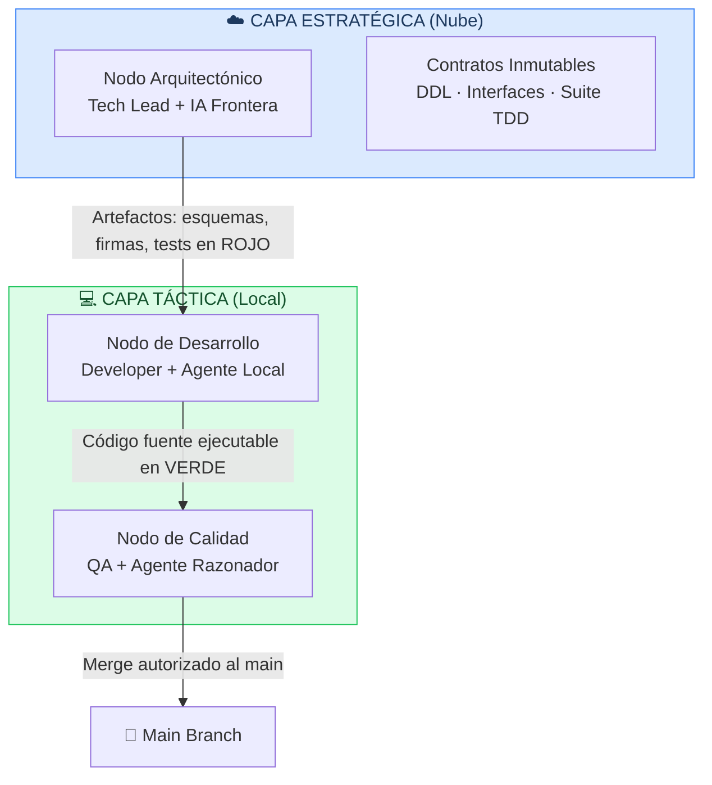
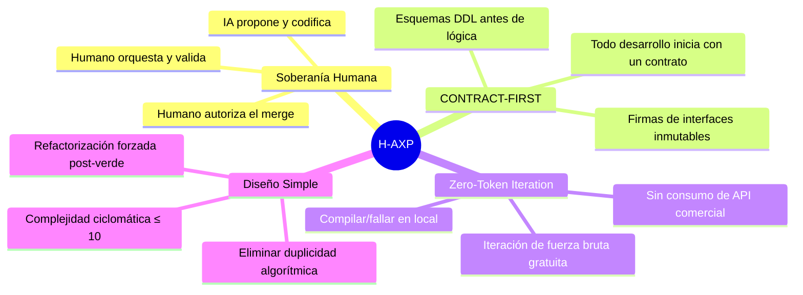
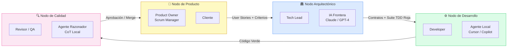
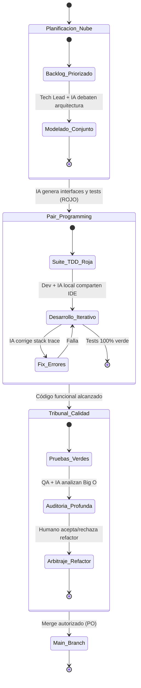

# 🤖 Hybrid-Agentics eXtreme Programming (H-AXP)

> **Autor:** Bruno Guzmán · Asunción, Paraguay · 08/10/2026  
> **Categoría:** Metodología Ágil · Inteligencia Artificial · Ingeniería de Software

[](LICENSE)
[](#)
[](#)

---

## ¿Qué es H-AXP?

**H-AXP** es un marco de desarrollo de software híbrido y simbiótico que sintetiza la gobernanza macroscópica de **Scrum** con el rigor microscópico de **Extreme Programming (XP)**, estructurando el trabajo en torno a "Equipos H-AXP": binomios **Humano + Agente de IA** que operan como unidades de producción cohesionadas.

La metodología responde a tres problemas críticos del desarrollo asistido por IA no estructurado:

| Problema | Descripción |
|---|---|
| 🌀 **Vibe Coding** | Delegación desestructurada que produce prototipos frágiles sin contratos formales |
| 🏚️ **Deriva Arquitectónica** | Los LLMs mutan contratos e interfaces para resolver fallos locales de compilación |
| 💸 **Costo de Inferencia** | El uso irrestricto de APIs comerciales en el bucle de compilación genera costos inviables |

---

## Arquitectura de Dos Capas



---

## Los Cuatro Axiomas



---

## Topología del Equipo (Nodos Simbióticos)



---

## Ciclo de Vida: El Micro-Sprint

El Micro-Sprint reemplaza el sprint tradicional de 2–4 semanas por **iteraciones de 3 a 7 días**, enfocadas en un único componente funcional aislable.



---

## Métricas de Rendimiento

| Métrica | Sigla | Umbral H-AXP |
|---|---|---|
| Densidad de Defectos | DD | ≤ 0.5 defectos / KLOC |
| Tasa de Mutación de Contratos | CMR | **0%** (bloqueo absoluto) |
| Ratio de Tests Locales | LTPR | ≥ 85% en runtime local |
| Costo de Tokens por Feature | TCF | < 4.500 tokens totales |
| Complejidad Ciclomática | M | M ≤ 10 por método |

---

## Hipótesis

> **H₀ (Nula):** La aplicación del ciclo H-AXP *no* genera variaciones estadísticamente significativas en la tasa de defectos, la estabilidad de contratos y el costo por funcionalidad en comparación con el desarrollo ágil tradicional asistido por chat no estructurado.

> **H₁ (Alternativa):** La segregación de responsabilidades en Nodos Simbióticos H-AXP, junto con el ciclo TDD Zero-Token y el micro-contexting, reduce la deuda técnica, elimina la mutación no autorizada de interfaces y reduce el costo de inferencia **por encima del 70%**.

---

## Estructura del Repositorio

```
h-axp/
├── README.md                          ← Este archivo
├── docs/
│   ├── 01-introduccion.md             ← Contexto y motivación
│   ├── 02-antecedentes.md             ← Estado del arte
│   ├── 03-marco-evaluacion.md         ← Framework de evaluación empírica
│   ├── 04-fundamentos-topologia.md    ← Axiomas y estructura del equipo
│   ├── 05-ciclo-de-vida.md            ← Micro-Sprints y ceremonias
│   ├── 06-practicas-tdd-zero-token.md ← TDD, Red-Green-Refactor
│   ├── 07-gobernanza-contexto.md      ← System Prompts y Micro-Contexting
│   ├── 08-matriz-riesgos.md           ← Riesgos y protocolos de fallback
│   ├── 09-etica-propiedad-intelectual.md ← Consideraciones éticas
│   └── 10-conclusiones.md             ← Conclusiones y trabajo futuro
├── diagrams/
│   ├── arquitectura-dos-capas.md      ← Diagrama de capas Nube/Local
│   ├── topologia-equipo.md            ← Mapa de roles y nodos
│   ├── micro-sprint-estados.md        ← Máquina de estados del Micro-Sprint
│   ├── red-green-refactor.md          ← Flujo TDD Zero-Token
│   └── protocolo-oom.md               ← Protocolo de contingencia de hardware
├── prompts/
│   ├── nodo-arquitectonico.md         ← System Prompt: Domain Architect
│   ├── nodo-tactico.md                ← System Prompt: Tactical Execution Agent
│   └── nodo-calidad.md                ← System Prompt: Logical Auditor Agent
└── templates/
    ├── user-story-template.md         ← Plantilla de Historia de Usuario
    ├── micro-sprint-checklist.md      ← Checklist de Definition of Done
    └── injection-variables-canvas.md  ← Canvas de variables de inyección
```

---

## Palabras Clave

`Metodologías Ágiles` · `Extreme Programming` · `Scrum` · `Inteligencia Artificial Generativa` · `Test-Driven Development (TDD)` · `Sistemas Multi-Agente` · `Equipos Híbridos` · `Micro-Contexting` · `Zero-Token` · `LLMs`

---

## Licencia

Este trabajo es de elaboración propia de **Bruno Guzmán** (Asunción, Paraguay).  
Distribuido bajo licencia [MIT](LICENSE).
