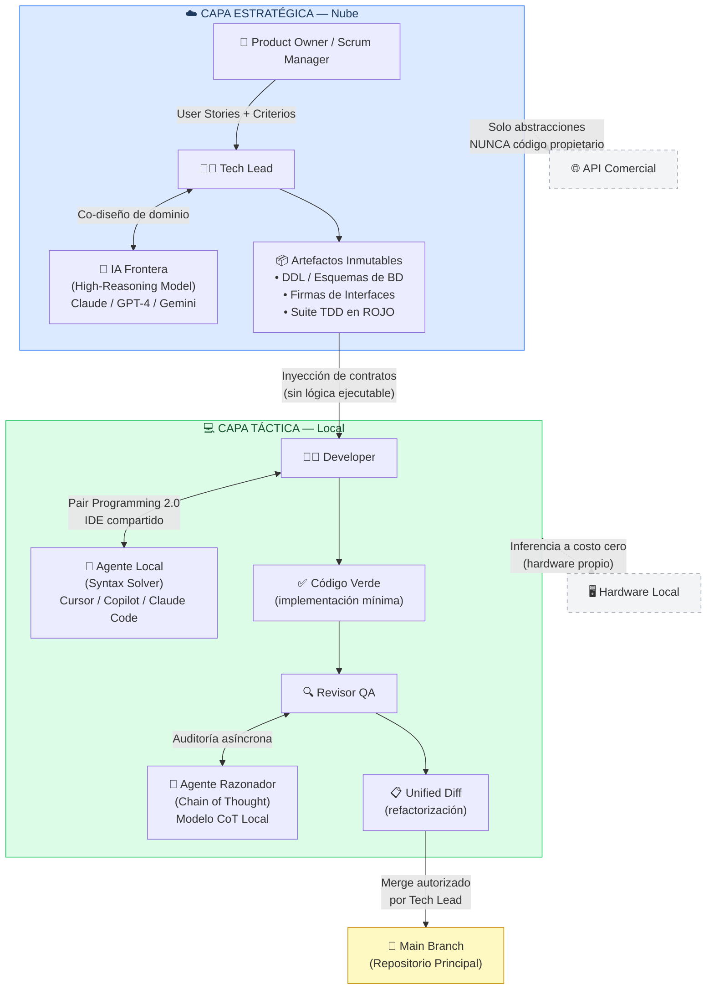
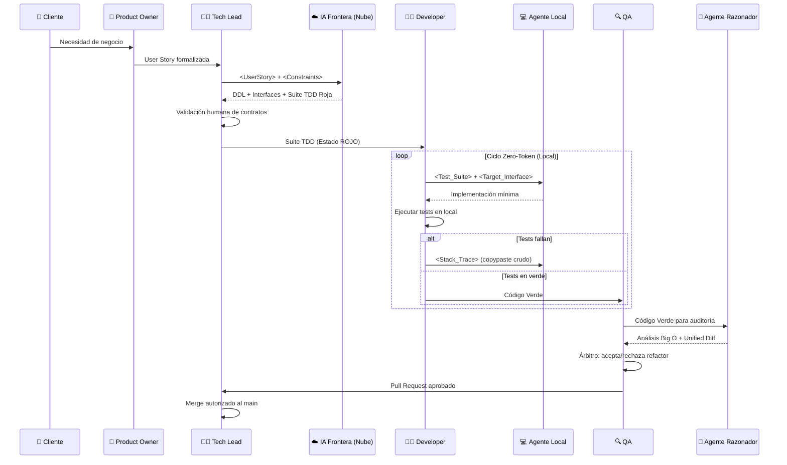

# 🏛️ Diagrama: Arquitectura de Dos Capas H-AXP

> Representa la separación fundamental entre la Capa Estratégica (Nube) y la Capa Táctica (Local).

---

## Diagrama Principal

---

## Flujo de Artefactos

---

## Principio de Separación de Información

| Información | ¿Sale a la Nube? | Justificación |
|---|---|---|
| `<UserStory>` abstracta | ✅ Sí | Solo describe el QUÉ, sin implementación |
| Esquema DDL sin datos | ✅ Sí | Estructura, no contenido sensible |
| Firmas de interfaces | ✅ Sí | Contratos abstractos, sin lógica |
| Lógica de negocio ejecutable | ❌ Nunca | Código propietario — permanece en local |
| Algoritmos internos | ❌ Nunca | Propiedad intelectual corporativa |
| Datos reales / PII | ❌ Nunca | Cumplimiento GDPR y privacidad |
| Stack traces de compilación | ❌ Nunca | Solo se inyectan al agente local |

---

← [Volver a Documentación](../docs/) | [Volver al README](../README.md)
