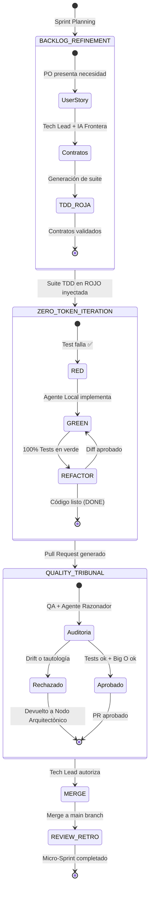
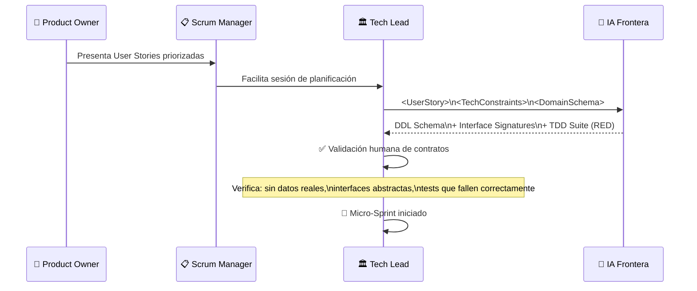
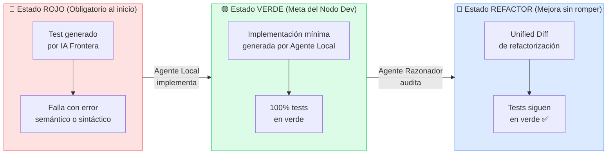

# ⚙️ Diagrama: Estados del Micro-Sprint H-AXP

> Máquina de estados completa del ciclo de vida de un Micro-Sprint.

---

## Máquina de Estados del Micro-Sprint

---

## Diagrama de Flujo del Sprint Planning

---

## Estados de los Tests a lo Largo del Ciclo

---

## Ceremonias del Micro-Sprint

| Ceremonia | Frecuencia | Duración | Participantes | Resultado |
|---|---|---|---|---|
| **Sprint Planning** | Inicio de cada Micro-Sprint | 1–2 horas | PO + SM + Tech Lead + IA Frontera | Suite TDD ROJA + Contratos |
| **Daily Stand-up** | Diario | 15 minutos | Todo el equipo | Sincronización de bloqueos |
| **Tribunal de Calidad** | Al completar implementación | 30–45 minutos | QA + Agente Razonador + Tech Lead | Decisión de merge |
| **Review / Retrospectiva** | Fin de cada Micro-Sprint | 1 hora | Todo el equipo | Ajuste de proceso |

---

← [Volver a Documentación](../docs/) | [Volver al README](../README.md)
