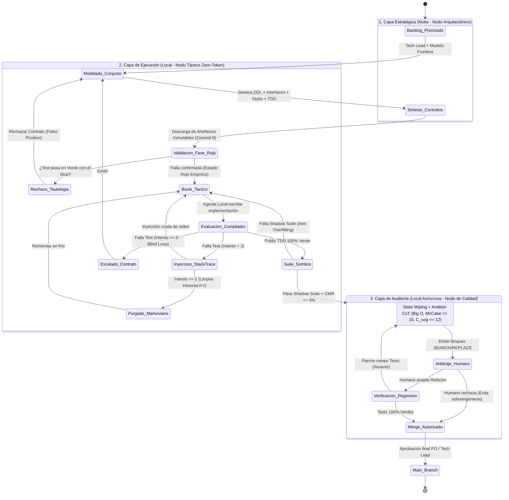
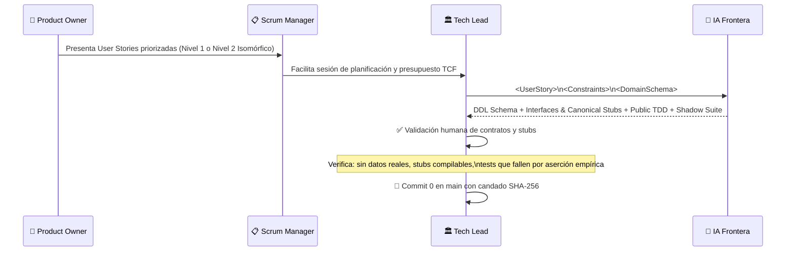
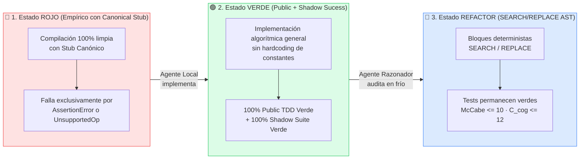

# ⚙️ Diagrama: Estados del Micro-Sprint H-AXP

> Máquina de estados completa del ciclo de vida de un Micro-Sprint.

---

## Máquina de Estados del Micro-Sprint (v2.0)

---

## Diagrama de Flujo del Sprint Planning

---

## Estados de los Tests a lo Largo del Ciclo

---

## Ceremonias del Micro-Sprint (v2.0)

| Ceremonia | Frecuencia | Duración | Participantes | Resultado |
|---|---|---|---|---|
| **Sprint Planning** | Inicio de cada Micro-Sprint | 1–2 horas | PO + SM + Tech Lead + IA Frontera | DDL + Interfaces + Stubs + TDD Pública y Sombra (Commit 0) |
| **Bucle Táctico Continuo (CTL)** | Continuo en IDE | Variable (sesión dev) | Dev (Navegante) + Agente Local (Conductor) | Implementación Verde funcional ($TCF = 0$) |
| **Contract Sync Daily (CSD)** | Diario (multi-equipo) | $\le 10$ minutos | Binomios H-AXP paralelos | Sincronización de excepciones CEP entre contratos |
| **Tribunal de Calidad** | Al completar implementación | 20–30 minutos | QA + Agente Razonador + Tech Lead | Arbitraje humano ($HATR \le 25\%$) de parches SEARCH/REPLACE |
| **Review / Retrospectiva Paramétrica** | Fin de cada Micro-Sprint | 45 minutos | Todo el equipo | Calibración de System Prompts, KV Cache y métricas empíricas |

---

← [Volver a Documentación](../docs/) | [Volver al README](../README.md)
