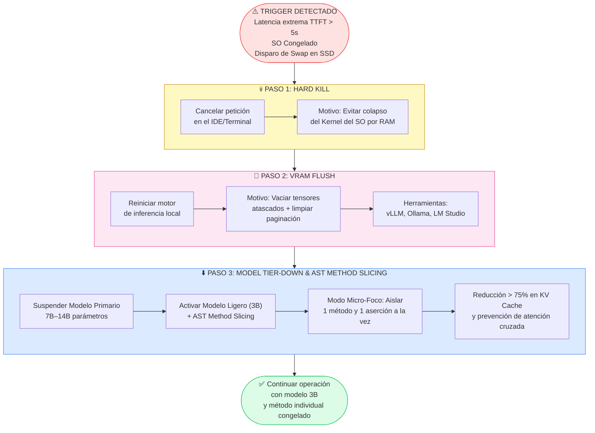
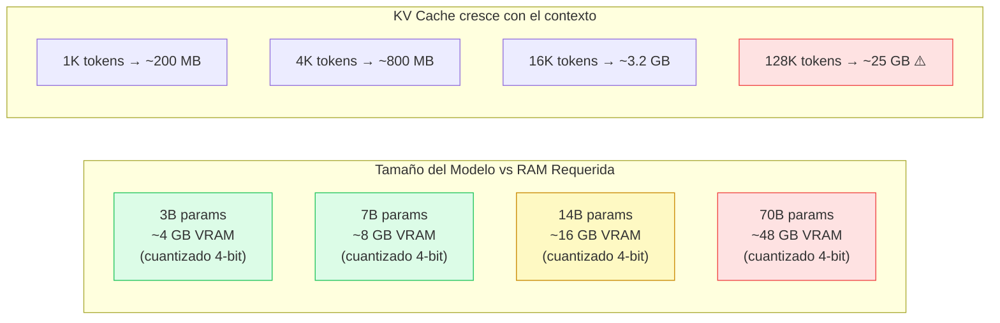
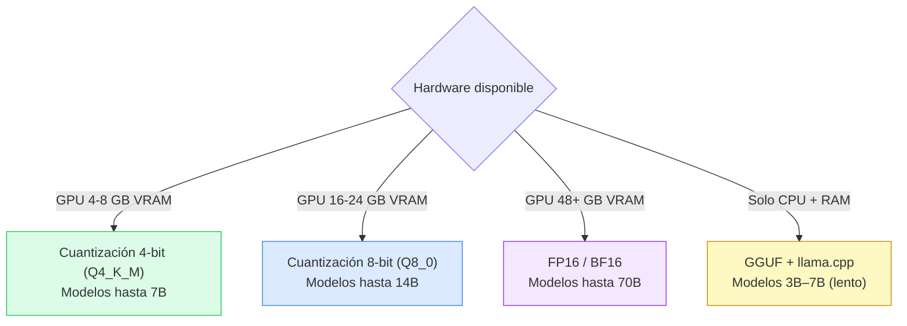

# 💾 Diagrama: Protocolo de Contingencia OOM (Out of Memory)

> Protocolo de respuesta ante desbordamiento de KV Cache en hardware local.

---

## Diagrama de Flujo OOM

---

## Relación KV Cache — Memoria Física

---

## Umbrales de Alerta

| Métrica | ✅ Normal | ⚠️ Advertencia | 🚨 Crítico (OOM) |
|---|---|---|---|
| **RAM / VRAM ocupada** | < 60% | 60–85% | > 85% |
| **TTFT (Time To First Token)** | < 1s | 1–5s | > 5s |
| **Tokens por segundo** | > 10 tok/s | 5–10 tok/s | < 5 tok/s |
| **Uso de Swap en SSD** | 0% | 1–20% | > 20% |
| **Temperatura del SSD** | < 60°C | 60–70°C | > 70°C ♨️ |

---

## Estrategia de Cuantización Recomendada

---

## Herramientas de Motor de Inferencia Local

| Motor | Plataforma | GPU Compatible | Uso en H-AXP |
|---|---|---|---|
| **Ollama** | macOS / Linux / Windows | CUDA, Metal, ROCm | Desarrollo local rápido |
| **LM Studio** | macOS / Windows | Metal, CUDA | Equipo no técnico |
| **vLLM** | Linux | CUDA | Producción / Servidores |
| **llama.cpp** | Multiplataforma | CPU + GPU | Máxima compatibilidad |
| **Jan.ai** | macOS / Windows / Linux | CUDA, Metal | Alternativa a LM Studio |

---

← [Volver a Documentación](../docs/) | [Volver al README](../README.md)
