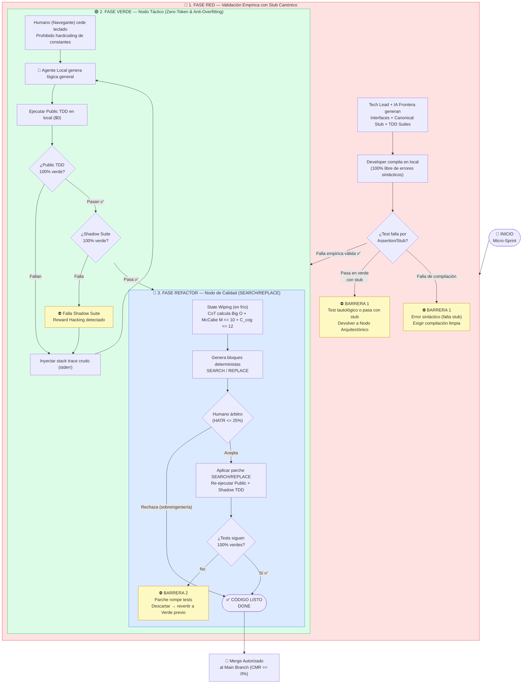
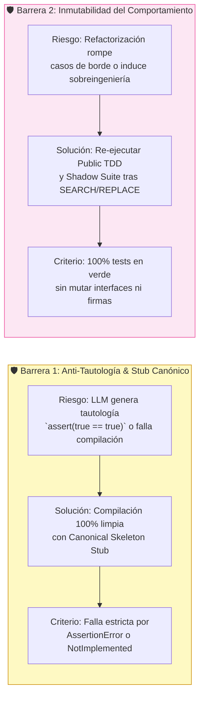

# 🔴🟢🔵 Diagrama: Ciclo Red-Green-Refactor H-AXP (Zero-Token)

---

## Flujo Completo del Ciclo TDD Zero-Token



---

## Las Dos Barreras de Calidad (v2.0)



---

## Ejemplo de Inyección Correcta de Stack Trace

```xml
<!-- ✅ Correcto: copypaste crudo del compilador -->
<Stack_Trace>
FAIL: test_user_registration_with_duplicate_email
  AssertionError: Expected UserAlreadyExistsException but got None
  at UserService.register (UserService.java:45)
  at UserServiceTest.java:23
</Stack_Trace>

<Target_Interface_And_Stub>
interface UserService {
    UserDTO register(RegisterDTO dto) throws UserAlreadyExistsException;
}

class UserServiceStub implements UserService {
    public UserDTO register(RegisterDTO dto) throws UserAlreadyExistsException {
        throw new UnsupportedOperationException("H-AXP Red State Stub");
    }
}
</Target_Interface_And_Stub>

<!-- ❌ Incorrecto: descripción en lenguaje natural (sesga la IA) -->
<!-- "Creo que el problema es que el método no lanza la excepción..." -->
```

---

← [Volver al README](../README.md)
