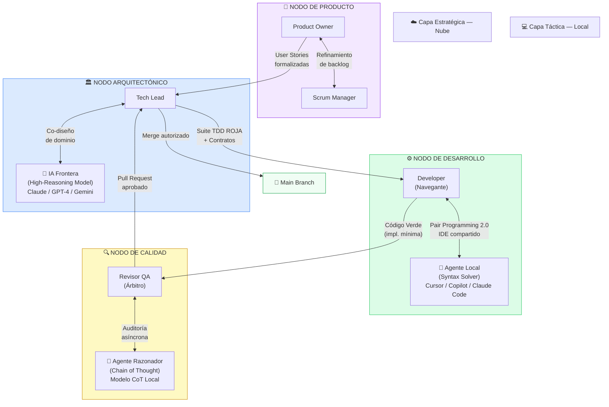
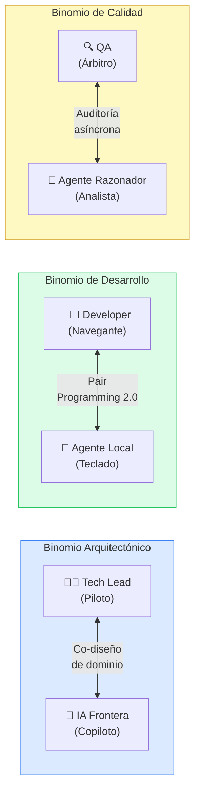

# 🗺️ Diagrama: Topología del Equipo H-AXP

> Los cuatro Nodos Simbióticos y sus relaciones operativas.

---

## Diagrama de Topología Completa

---

## Tabla de Responsabilidades por Nodo

| Nodo | Rol Humano | Rol IA | Artefacto de Entrada | Artefacto de Salida |
|---|---|---|---|---|
| **🎯 Producto** | Product Owner + Scrum Manager | — | Necesidad de negocio | User Story formalizada |
| **🏛️ Arquitectónico** | Tech Lead | IA Frontera (Nube) | User Story | Suite TDD ROJA + DDL + Interfaces |
| **⚙️ Desarrollo** | Developer (Navegante) | Agente Local (Táctico) | Suite TDD ROJA | Código Verde (implementación mínima) |
| **🔍 Calidad** | Revisor QA (Árbitro) | Agente Razonador (CoT) | Código Verde | Unified Diff + Pull Request aprobado |

---

## Binomios Humano-IA por Nodo

---

## Principio de Soberanía Humana

En todos los Nodos Simbióticos, el humano mantiene la **decisión final** (Human-in-the-loop):

- **Tech Lead** → Valida y autoriza contratos antes de enviarlos al Nodo de Desarrollo
- **Developer** → Árbitro de la calidad del código generado; decide qué stack trace inyectar
- **QA** → Acepta o rechaza el Unified Diff de refactorización

> "La IA acelera; el humano decide."

---

← [Volver a Documentación](../docs/) | [Volver al README](../README.md)
