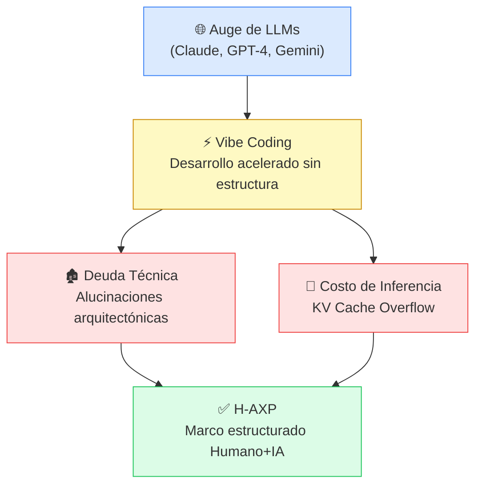

# 📖 Introducción

> **H-AXP** · Hybrid-Agentics eXtreme Programming

---

## Contexto

La convergencia de la inteligencia artificial generativa con la ingeniería de software ha transformado sustancialmente el ciclo de vida del desarrollo de sistemas. Entornos y herramientas basados en agentes inteligentes tales como **Claude Code**, **Codex**, **Antigravity** y **Cursor** han incrementado la eficiencia operativa y propiciado paradigmas emergentes de programación asistida, frecuentemente denominados en la literatura técnica como *vibe coding*.

En el marco de las metodologías ágiles, para maximizar esta eficiencia operativa **sin sacrificar la precisión y el rigor técnico** en proyectos de pequeña y mediana escala, se introduce la metodología **Hybrid-Agentic Extreme Programming (H-AXP)**: un modelo híbrido que articula las prácticas técnicas y de aseguramiento de calidad de *Extreme Programming* (XP) con el marco operativo y de gestión de Scrum.

---

## Motivación

El presente documento formaliza la metodología H-AXP mediante una arquitectura modular, orientada a su:

- **Estandarización**: definición de roles, artefactos y ceremonias reproducibles
- **Reproducibilidad**: protocolos deterministas que eliminan la ambigüedad
- **Adopción**: accesibilidad para la comunidad técnica y académica

---

## Diagrama de Motivación

---

## Resumen Ejecutivo

El auge de los Modelos de Lenguaje Grande (LLMs) ha transformado la ingeniería de software hacia paradigmas asistidos por agentes, generando incrementos significativos en velocidad pero introduciendo riesgos críticos de:

- **Deuda técnica**
- **Alucinaciones arquitectónicas**
- **Degradación de hardware local**

H-AXP estructura el desarrollo en "Equipos H-AXP" (binomios Humano-IA) distribuidos en una arquitectura desacoplada de dos niveles:

| Capa | Función | Tecnología |
|---|---|---|
| **Estratégica (Nube)** | Diseño de dominio y generación de contratos inmutables | Modelos fundacionales de frontera |
| **Táctica (Local)** | Iteración de fuerza bruta bajo el principio Zero-Token | Modelos locales especializados |

Mediante técnicas de **micro-contextualización**, barreras formales de *Fail-First TDD* y protocolos rigurosos de mitigación de riesgos y desbordamiento de memoria, H-AXP:

- ✅ Garantiza la soberanía del diseño humano
- ✅ Previene la deriva arquitectónica
- ✅ Optimiza el consumo de recursos computacionales sin incurrir en costos continuos de API externas

---

**Palabras clave:** Metodologías Ágiles · Extreme Programming · Scrum · Inteligencia Artificial Generativa · Test-Driven Development (TDD) · Sistemas Multi-Agente · Equipos Híbridos · Micro-Contexting

---

← [Volver al README](../README.md) | [Siguiente: Antecedentes →](02-antecedentes.md)
