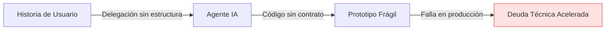
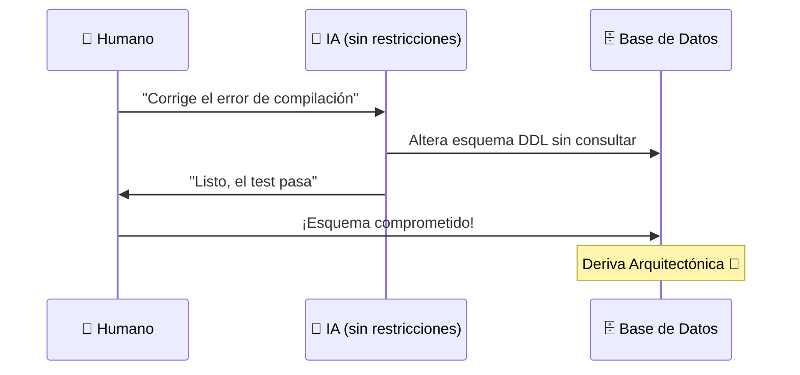
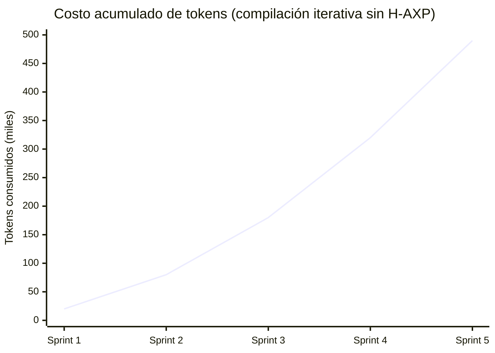

# 🔬 Antecedentes y Estado del Arte

---

## La Transición hacia el Paradigma Agéntico en Ingeniería de Software

Las metodologías de desarrollo tradicionales han dependido históricamente de la sincronización y el consenso humano. Frameworks como Scrum gestionan la latencia comunicacional mediante ciclos de dos a cuatro semanas, mientras que XP asegura la calidad del código fuente a través de la integración continua y el *Pair Programming*.

Sin embargo, la integración de modelos fundacionales entrenados en código fuente ha alterado la dinámica de producción en tres ejes críticos:

---

### 1. El Fenómeno del *Vibe Coding*

La delegación desestructurada de tareas a agentes conversacionales genera prototipos funcionales rápidos, pero adolece de:

- Falta de contratos formales
- Nula verificabilidad
- Fragilidad ante casos de borde



---

### 2. El Problema de la Deriva Arquitectónica (*Architectural Drift*)

Al no operar bajo restricciones deterministas, los LLMs tienden a:

- **Mutar contratos existentes** para resolver fallos locales de compilación
- **Reescribir esquemas de base de datos** sin autorización
- **Asumir dependencias inexistentes** para satisfacer el test inmediato



---

### 3. Costos y Cuellos de Botella de Inferencia

El uso irrestricto de APIs comerciales en la nube genera inviabilidad financiera en ciclos iterativos de compilación, mientras que la inferencia local sin control de contexto colapsa la memoria física (*KV Cache overflow*) de las estaciones de trabajo de los desarrolladores.



---

## Respuesta de H-AXP a la Brecha Epistemológica

H-AXP responde a esta brecha combinando:

| Origen | Contribución |
|---|---|
| **Extreme Programming (XP)** | Disciplina técnica clásica: TDD, Pair Programming, Diseño Simple, Integración Continua |
| **Scrum** | Marco de gestión: Sprints, Product Owner, Backlog, Ceremonias |
| **Topología moderna de IA** | Inferencia híbrida: modelos de frontera en nube + modelos locales especializados |

```mermaid
flowchart TD
    title[<b>Fundamentos de H-AXP</b>]
    XP["<b>Extreme Programming (XP)</b><br/>• TDD Fail-First<br/>• Rigor técnico"] 
    SCRUM["<b>SCRUM</b><br/>• Micro-Sprints<br/>• Gobernanza ágil"]
    IA["<b>IA Agéntica</b><br/>• Inferencia híbrida<br/>• Ejecución Zero-Token"]
    HAXP["<b>H-AXP\n(Síntesis)</b>"]
    XP --> HAXP
    SCRUM --> HAXP
    IA --> title
    HAXP--> title


    style HAXP fill:#1e3a8a,stroke:#3b82f6,stroke-width:3px,color:#ffffff
    style XP fill:#1f2937,stroke:#4b5563,stroke-width:1px,color:#ffffff
    style SCRUM fill:#1f2937,stroke:#4b5563,stroke-width:1px,color:#ffffff
    style IA fill:#1f2937,stroke:#4b5563,stroke-width:1px,color:#ffffff
````

---

← [Anterior: Introducción](01-introduccion.md) | [Siguiente: Marco de Evaluación →](03-marco-evaluacion.md)
