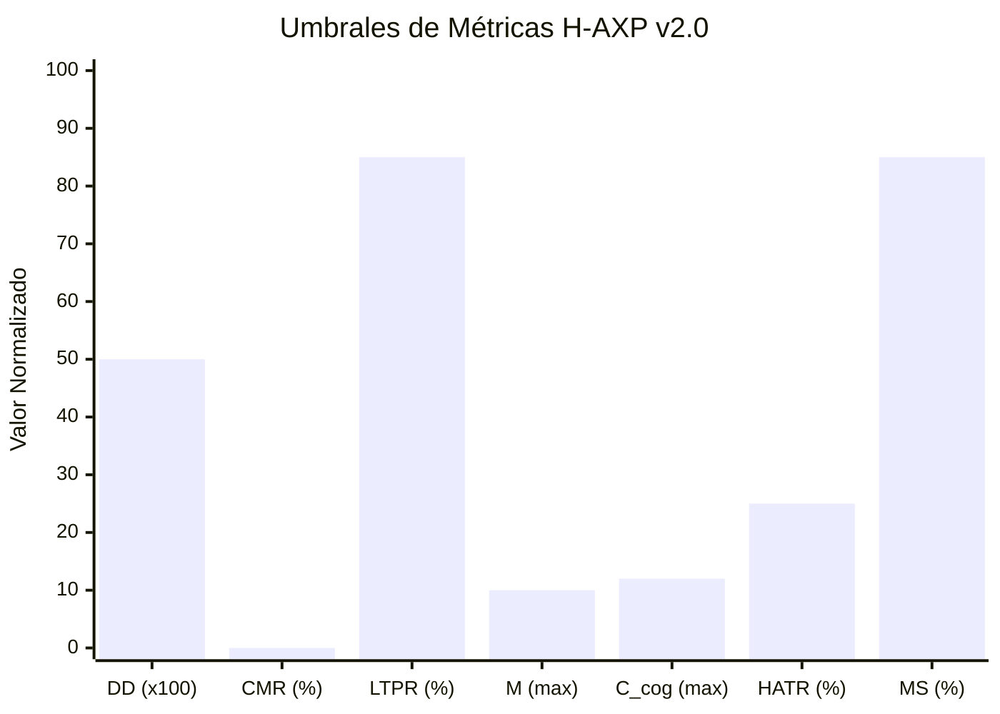
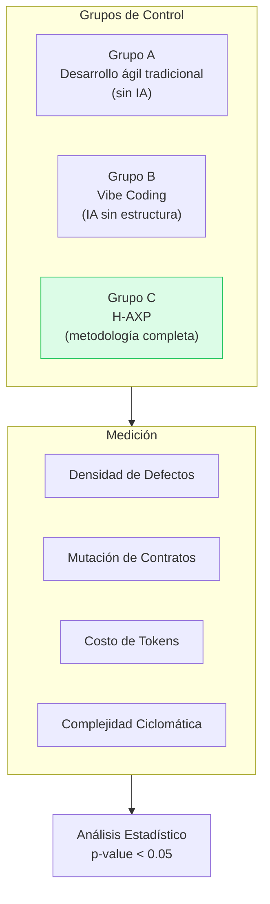

# 📊 Marco de Evaluación Empírica

---

Para validar científicamente la eficacia del marco H-AXP frente a métodos tradicionales y enfoques de IA no estructurados, se establece el siguiente diseño experimental.

---

## Formulación de Hipótesis

### Hipótesis Nula (H₀)

> La aplicación del ciclo H-AXP **no** genera variaciones estadísticamente significativas en la tasa de defectos, la estabilidad de contratos y el costo por funcionalidad en comparación con el desarrollo ágil tradicional asistido por chat no estructurado.

### Hipótesis Alternativa (H₁)

> La segregación de responsabilidades en Nodos Simbióticos H-AXP, junto con el ciclo TDD Zero-Token y el micro-contexting, **reduce la deuda técnica, elimina la mutación no autorizada de interfaces y reduce el costo de inferencia por encima del 70%**.

---

## Variables del Experimento y Métricas de Rendimiento (v2.0)

Para garantizar una evaluación cuantitativa rigurosa y reproducible, el marco H-AXP define un conjunto ampliado de métricas formales:

| Métrica | Dimensión | Método de Medición y Formulación Matemática | Umbral Esperado H-AXP |
|---|---|---|---|
| **Defect Density (DD)** | Calidad Externa | Defectos encontrados en *staging* por cada KLOC (Kilo Lines of Code): $$DD = \frac{\text{Defectos Post-Merge}}{\text{KLOC}}$$ | ≤ 0.5 defectos / KLOC |
| **Contract Mutation Rate (CMR)** | Integridad Arquitectónica | Porcentaje de *pull requests* que alteran interfaces o esquemas DDL protegidos sin aprobación del Tech Lead: $$CMR = \left( \frac{\text{PRs con alteraciones no autorizadas}}{\text{Total de PRs evaluados}} \right) \times 100\%$$ | **0.0%** (Bloqueo absoluto por Git Hook) |
| **Local Test Pass Ratio (LTPR)** | Eficiencia Local | Proporción de suites TDD resueltas puramente en el runtime local sin recurrir a APIs de nube: $$LTPR = \left( \frac{\text{Suites resueltas en local}}{\text{Total de suites ejecutadas}} \right) \times 100\%$$ | ≥ 85% de las pruebas |
| **Token Cost per Feature ($TCF_{total}$)** | Viabilidad Económica | Sumatoria de tokens de entrada, razonamiento interno y salida consumidos en la Capa Estratégica: $$TCF_{total} = \sum_{i=1}^{N_{sesiones}} \left( T_{input}^{(i)} + T_{reasoning}^{(i)} + T_{output}^{(i)} \right)$$ | $TCF_{I/O} \le 4.500$ tokens ($TCF_{total} \le 12.000$ incl. razonamiento) |
| **Complejidad Ciclomática ($\mathcal{M}$)** | Mantenibilidad Estructural | Complejidad de McCabe calculada sobre el grafo de flujo de control $G = (V, E, P)$: $$\mathcal{M} = E - V + 2P$$ | $\mathcal{M} \le 10$ por método |
| **Complejidad Cognitiva ($\mathcal{C}_{cog}$)** | Legibilidad y Comprensión | Penalización incremental por nivel de anidamiento $d$ para mitigar fatiga cognitiva: $$\mathcal{C}_{cog} = \sum_{j \in \text{Estructuras}} (1 + d_j)$$ | $\mathcal{C}_{cog} \le 12$ por método |
| **Human Arbitration Time Ratio ($HATR$)** | Eficiencia Human-in-the-Loop | Proporción del tiempo del micro-sprint invertida por el humano en arbitraje crítico vs codificación manual: $$HATR = \frac{t_{planning\_review} + t_{diff\_arbitration}}{t_{total\_micro\_sprint}} \times 100\%$$ | $HATR \le 25\%$ |
| **Mutation Score de la Suite TDD ($MS$)** | Robustez Anti-Tautológica | Porcentaje de mutantes sintácticos inyectados que son detectados y eliminados por la suite TDD: $$MS = \left( \frac{\text{Mutantes Eliminados}}{\text{Total de Mutantes No Equivalentes}} \right) \times 100\%$$ | $MS \ge 85\%$ |

---

## Visualización de Umbrales

---

## Diseño del Experimento

---

← [Anterior: Antecedentes](02-antecedentes.md) | [Siguiente: Fundamentos y Topología →](04-fundamentos-topologia.md)
