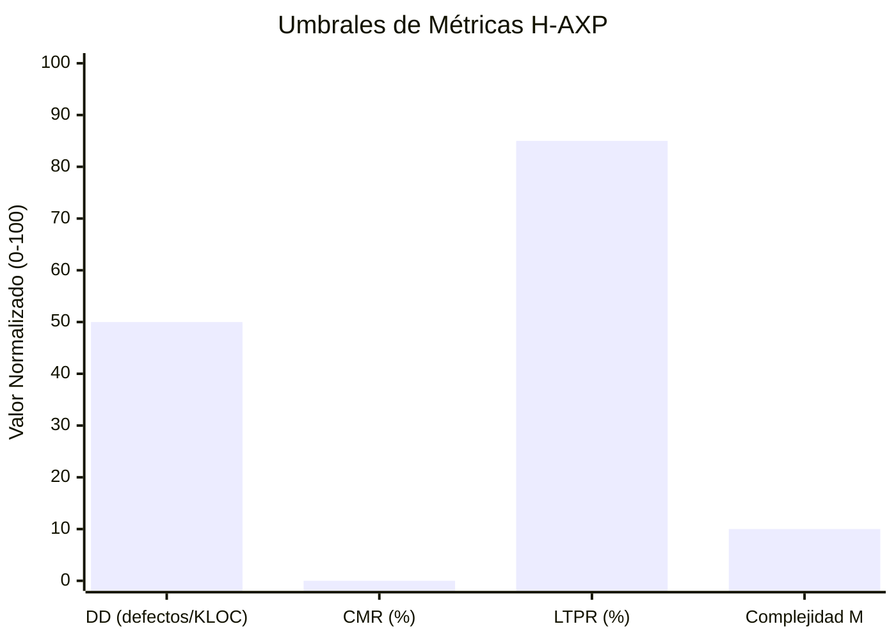
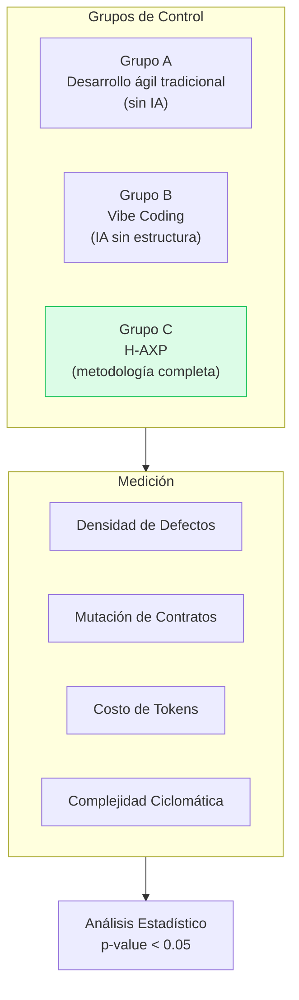

# 📊 Marco de Evaluación Empírica

---

Para validar científicamente la eficacia del marco H-AXP frente a métodos tradicionales y enfoques de IA no estructurados, se establece el siguiente diseño experimental.

---

## Formulación de Hipótesis

### Hipótesis Nula (H₀)

> La aplicación del ciclo H-AXP **no** genera variaciones estadísticamente significativas en la tasa de defectos, la estabilidad de contratos y el costo por funcionalidad en comparación con el desarrollo ágil tradicional asistido por chat no estructurado.

### Hipótesis Alternativa (H₁)

> La segregación de responsabilidades en Nodos Simbióticos H-AXP, junto con el ciclo TDD Zero-Token y el micro-contexting, **reduce la deuda técnica, elimina la mutación no autorizada de interfaces y reduce el costo de inferencia por encima del 70%**.

---

## Variables del Experimento y Métricas de Rendimiento

| Métrica | Dimensión | Método de Medición | Umbral Esperado H-AXP |
|---|---|---|---|
| **Defect Density (DD)** | Calidad Externa | Defectos encontrados en *staging* por cada KLOC (Kilo Lines of Code) | ≤ 0.5 defectos / KLOC |
| **Contract Mutation Rate (CMR)** | Integridad | Porcentaje de *pull requests* que alteran interfaces sin aprobación del Tech Lead | **0%** (Bloqueo absoluto) |
| **Local Test Pass Ratio (LTPR)** | Eficiencia Local | Proporción de suites TDD resueltas puramente en el runtime local | ≥ 85% de las pruebas |
| **Token Cost per Feature (TCF)** | Viabilidad Económica | Total de tokens de entrada/salida consumidos en nube por Historia de Usuario | < 4.500 tokens totales |
| **Cyclomatic Complexity (M)** | Mantenibilidad | Complejidad de McCabe en los módulos post-auditoría algorítmica | M ≤ 10 por método |

---

## Visualización de Umbrales

---

## Diseño del Experimento

---

← [Anterior: Antecedentes](02-antecedentes.md) | [Siguiente: Fundamentos y Topología →](04-fundamentos-topologia.md)
