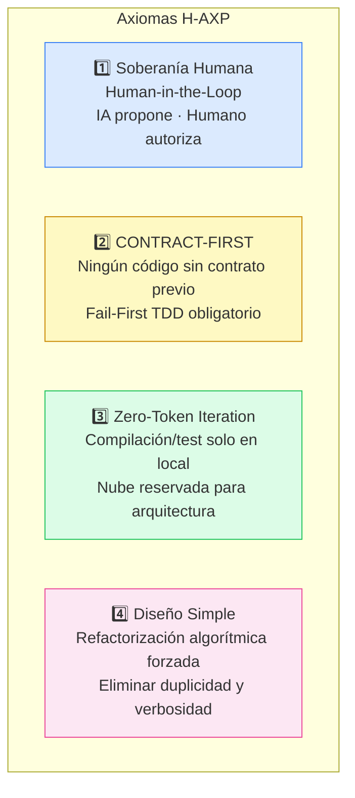

# 🏗️ Fundamentos y Topología de H-AXP

---

## Redefinición del Equipo de Desarrollo

El marco H-AXP redefine la asignación de recursos al tratar a los Modelos de Lenguaje Grande (LLMs) y entornos basados en agentes como Claude Code o Cursor **no como meras herramientas de autocompletado, sino como actores de primera clase dentro del equipo SCRUM**.

Para evitar la regresión técnica asociada al *Vibe Coding*, H-AXP impone restricciones de diseño simple y Test-Driven Development (TDD) propias de Extreme Programming.

---

## Los Cuatro Axiomas del Framework H-AXP

Toda iteración bajo esta metodología se rige en cuatro principios inmutables diseñados para proteger la integridad del sistema y optimizar el consumo de recursos computacionales, memoria y tokens.



### Axioma 1: Soberanía Humana y Arbitraje (Human-in-the-Loop)

La IA propone, estructura y codifica; el humano **orquesta, valida los criterios de aceptación y autoriza la integración al tronco principal**. El humano asume el rol de revisor crítico, no de tipógrafo.

### Axioma 2: Desacoplamiento CONTRACT-FIRST

Ningún agente de implementación debe escribir lógica de negocio ejecutable sin un contrato previo. Todo desarrollo inicia con:
1. Definición estricta de **esquemas de base de datos**
2. **Firmas de interfaces** inmutables
3. **Suite de pruebas unitarias** que inicialmente falla (Fail-First)

### Axioma 3: Zero-Token Iteration

El ciclo de ensayo y error (sintaxis, compilación, ejecución de tests) se delega **exclusivamente** a modelos de inferencia local. Los modelos fundacionales en la nube se reservan para planificación arquitectónica y auditoría de seguridad.

### Axioma 4: Diseño Simple Restringido

El código generado por IA tiende a la verbosidad. H-AXP impone la refactorización algorítmica forzada para:
- Eliminar la duplicidad
- Reducir el uso de memoria en tiempo de ejecución
- Maximizar la legibilidad

---

## Topología del Equipo: Los Nodos Simbióticos

La interacción no es conversacional, sino basada en el **intercambio de artefactos estructurados** (código, pruebas, esquemas). Cada nodo es un binomio Humano + IA que extiende el principio de *Pair Programming* de XP a todas las capas del ciclo de vida del software.

```mermaid
graph TB
    subgraph NODO_PRODUCTO["🎯 NODO DE PRODUCTO Y GOBERNANZA"]
        PO["Product Owner / Scrum Manager\n• Liderazgo estratégico\n• Gestión del presupuesto de tokens\n• Control de hitos de entrega"]
        CLI["Cliente\n• Define las reglas de negocio\n• Redacta Historias de Usuario con el PO"]
        IA_PO["IA Asistente\n• Mapea dependencias\n• Estima complejidad de User Stories\n• Detecta ambigüedades"]
    end

    subgraph NODO_ARQ["🏛️ NODO ARQUITECTÓNICO (Capa Nube)"]
        TL["Tech Lead + Arquitecto de Dominio\n• Traduce User Stories a contratos técnicos\n• Define esquemas DDL\n• Establece firmas de interfaces"]
        IA_NUBE["IA Frontera (High-Reasoning)\n• Modela UML, esquemas SQL, suite TDD\n• NO genera código ejecutable"]
    end

    subgraph NODO_DEV["⚙️ NODO DE DESARROLLO (Capa Local)"]
        DEV["Developer\n• Navega la estrategia algorítmica\n• Revisa lógica crítica\n• Itera ciclo Red-Green"]
        IA_LOCAL["Agente Local (Sintaxis)\n• Cursor / Copilot / Claude Code / Antigravity\n• Autocompleta funciones\n• Corrige stack traces"]
    end

    subgraph NODO_QA["🔍 NODO DE CALIDAD (Capa Auditoría Local)"]
        QA["Revisor de Código / QA\n• Elabora pruebas funcionales\n• Analiza Pull Requests\n• Árbitro de refactorizaciones"]
        IA_RAZON["Agente Razonador (CoT)\n• Evalúa Big O (complejidad temporal/espacial)\n• Detecta violaciones SOLID\n• Genera diffs de refactorización"]
    end

    NODO_PRODUCTO -->|"User Stories + Criterios de Aceptación"| NODO_ARQ
    NODO_ARQ -->|"Contratos técnicos + Suite TDD Roja"| NODO_DEV
    NODO_DEV -->|"Código Verde funcional"| NODO_QA
    NODO_QA -->|"Merge autorizado al main"| MAIN["🌿 Main Branch"]

    style NODO_PRODUCTO fill:#fef9c3,stroke:#ca8a04
    style NODO_ARQ fill:#dbeafe,stroke:#3b82f6
    style NODO_DEV fill:#dcfce7,stroke:#22c55e
    style NODO_QA fill:#fce7f3,stroke:#ec4899
```



---

## Especificaciones de Herramientas por Nodo

### Arquitectura Agnóstica de Herramientas (Tooling Taxonomy)

```
[1] NODO ARQUITECTÓNICO (Capa Estratégica / Nube)
┌─────────────────────────────────────────────────────────────────┐
│ Entorno:  Workspace colaborativo con soporte de artefactos      │
│ Interfaz: Plataforma conversacional estructurada o API de Nube  │
│ Motor:    Modelo Fundacional de Frontera (High-Reasoning)       │
│ Enfoque:  Diseño de dominio, esquemas DDL, contratos API y TDD  │
└─────────────────────────────────────────────────────────────────┘
              ↓ (Artefactos: Contratos técnicos, interfaces, tests en ROJO)

[2] NODO DE DESARROLLO (Capa de Ejecución / Local)
┌─────────────────────────────────────────────────────────────────┐
│ Entorno:  IDE / Editor con extensiones de IA                    │
│ Interfaz: Autocompletado contextual y chat de ventana corta     │
│ Motor:    Modelo de inferencia local especializado en código     │
│ Enfoque:  Pair Programming simbiótico, ciclo Red-Green          │
└─────────────────────────────────────────────────────────────────┘
              ↓ (Artefactos: Código fuente ejecutable en VERDE)

[3] NODO DE CALIDAD (Capa de Auditoría / Asíncrona Local)
┌─────────────────────────────────────────────────────────────────┐
│ Entorno:  CLI, Git Hooks o CI local                             │
│ Interfaz: Agente de terminal asíncrono o script de análisis     │
│ Motor:    Modelo de razonamiento local con CoT                  │
│ Enfoque:  Auditoría algorítmica, evaluación Big O, diffs        │
└─────────────────────────────────────────────────────────────────┘
```

---

## Regla de Autoridad del Cliente y el Programador

1. **El cliente dicta el "Qué":** Ningún agente de IA está autorizado a inventar flujos de negocio, suponer características no solicitadas o alterar las prioridades. El LLM tiene estrictamente prohibido alterar la historia de usuario original.

2. **El equipo de desarrollo dicta el "Cómo":** El cliente y el PO no imponen cómo se estructura el código, cómo se normaliza la base de datos o qué algoritmos de ordenamiento usar. Esa responsabilidad recae enteramente en el Arquitecto de Dominio y el Auditor.

---

## Matriz de Trazabilidad: SCRUM/XP Clásico → H-AXP

| Rol Clásico | Equivalente H-AXP | IA Asociada |
|---|---|---|
| Product Owner | Nodo de Producto (Humano) | IA asistente de análisis |
| Scrum Master | Scrum Manager H-AXP | IA de coordinación |
| Tech Lead | Nodo Arquitectónico (Humano) | IA Frontera (Nube) |
| Developer | Nodo de Desarrollo (Humano) | Agente Local (IDE) |
| QA / Tester | Nodo de Calidad (Humano) | Agente Razonador (CoT) |
| Cliente | Nodo de Producto (Cliente) | — |
| Stakeholder | Ecosistema (Validación) | — |

---

← [Anterior: Marco de Evaluación](03-marco-evaluacion.md) | [Siguiente: Ciclo de Vida →](05-ciclo-de-vida.md)
