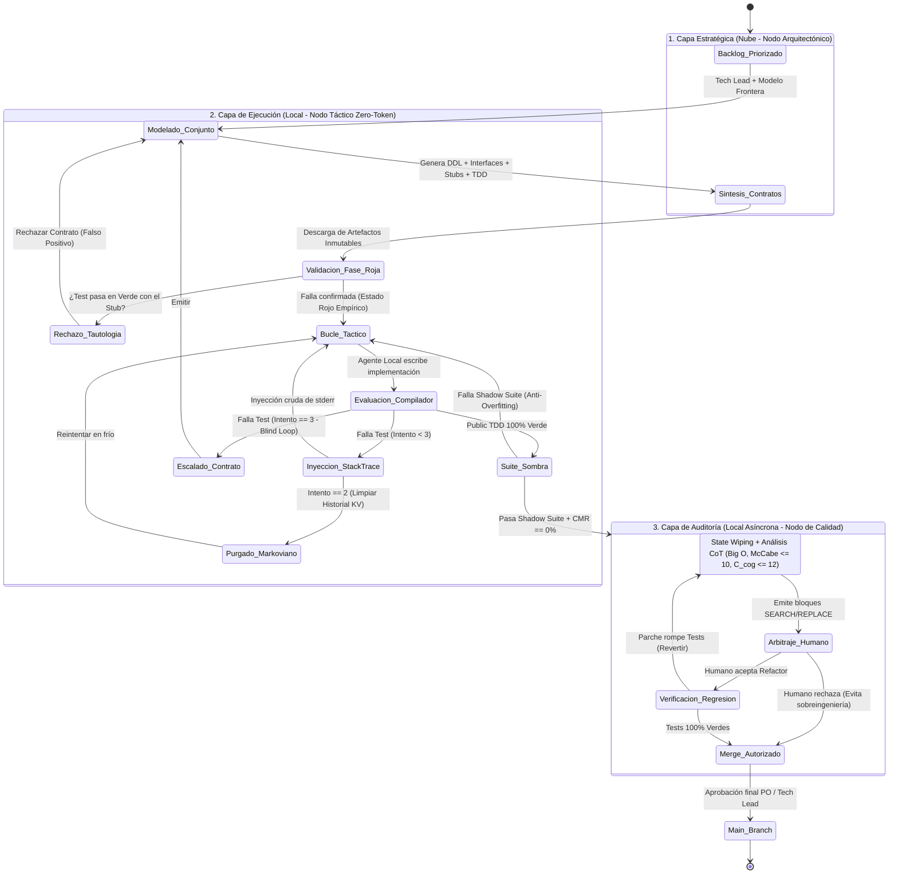
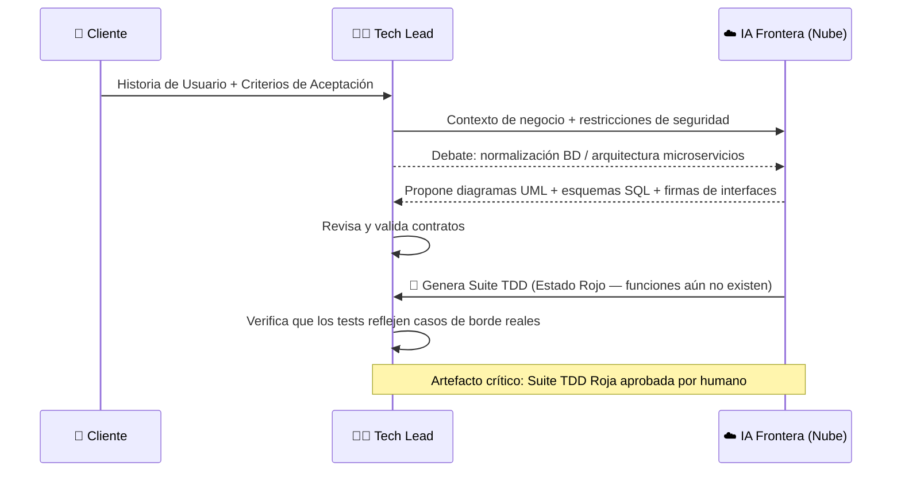
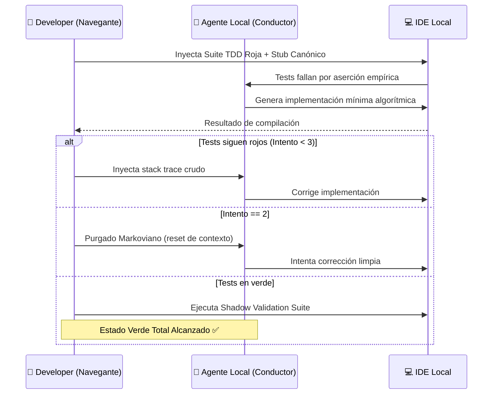
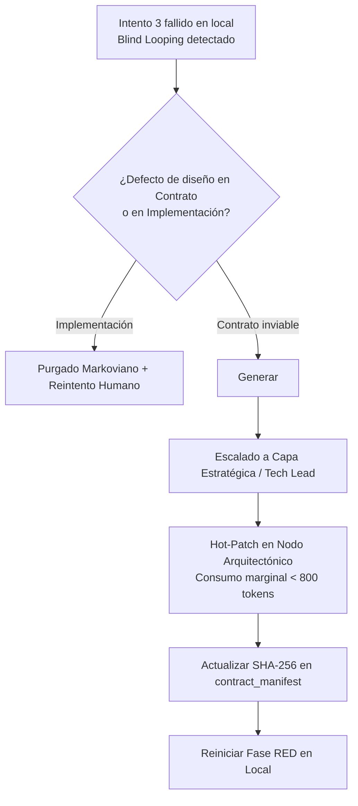
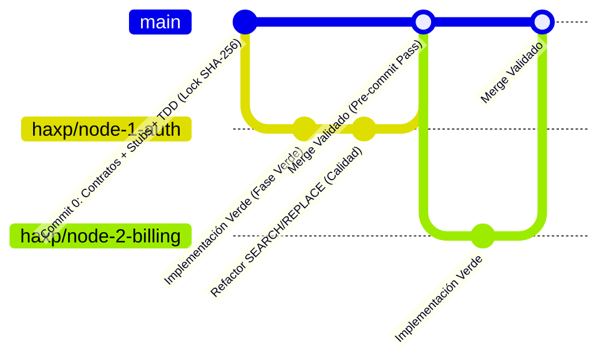

# 🔄 Ciclo de Vida H-AXP: Micro-Sprints y Ceremonias

---

## Arquitectura Temporal: el Micro-Sprint

H-AXP reemplaza el ciclo de 2 a 4 semanas por **Micro-Sprints de ejecución rápida**:

| Atributo | Valor |
|---|---|
| **Duración** | 3 a 7 días calendario |
| **Alcance** | Un componente funcional aislable |
| **Definition of Done (DoD)** | Código compila · Tests 100% verde · Auditoría algorítmica validada · Merge autorizado por humano |

Al introducir agentes autónomos que procesan lógica a la velocidad del hardware, el modelo H-AXP comprime radicalmente la temporalidad de las iteraciones, transformando los *Sprints* tradicionales en **Micro-Sprints** continuos orientados a componentes atómicos.

---

## Diagrama de Estados del Micro-Sprint (v2.0)

El siguiente grafo de estados formal modela el ciclo de vida completo de un Micro-Sprint en H-AXP, incluyendo las barreras de protección, el Purgado Markoviano, la Regla de 3 intentos con escalado de contratos y la validación mediante suites de pruebas sombra:

---

## Las Cuatro Ceremonias de Co-Creación

Las ceremonias ya no son traspasos asíncronos (*hand-offs*) en frío, sino **talleres de trabajo en tiempo real** donde el humano dirige la intuición y la estrategia, mientras la IA despliega su capacidad de procesamiento y estructuración.

---

### 1. 🗺️ Sprint Planning (Nodo Arquitectónico)

**Propósito:** Traducir las necesidades de negocio en contratos técnicos inmutables antes de escribir una sola línea de lógica.

**Dinámica de la sesión:**

**Artefacto de salida:** Suite de Pruebas Unitarias en **Estado Rojo** + contratos de interfaz.

---

### 2. ⚙️ Bucle Táctico Continuo (CTL) y Contract Sync Daily (CSD)

Para balancear la velocidad hiperacelerada del binomio local con la sincronización entre múltiples equipos H-AXP:

* **Bucle Táctico Continuo (*Continuous Tactical Loop - CTL*):** Es la sesión continua de *Pair Programming 2.0* dentro del IDE. El desarrollador humano actúa como *Navegante* y el agente local actúa como *Conductor*, iterando a costo cero (*Zero-Token*) guiado por la inyección de errores y pruebas en rojo.
* **Contract Sync Daily (*CSD*):** En organizaciones con múltiples binomios H-AXP trabajando en paralelo, reemplaza la daily tradicional por una **reunión humana de máximo 10 minutos**. Su único propósito es verificar si algún equipo requiere solicitar una excepción de contrato que impacte las interfaces de otro binomio en el Micro-Sprint actual.

**Roles en la sesión de CTL:**

| Rol | Actor | Responsabilidad |
|---|---|---|
| **Navegante** | Humano (Developer) | Define estrategia algorítmica, inyecta tests fallidos, vigila estructura y generalización |
| **Conductor** | Agente Local (IA) | Autocompleta bloques de lógica, lee stack traces, corrige sintaxis en milisegundos |

---

### 3. 🔍 Tribunal de Calidad (Nodo de Calidad)

**Propósito:** Aplicar la rigurosidad de Extreme Programming (Diseño Simple, DRY, SOLID) sobre el código ya funcional.

**Dinámica:**
1. El código funcional (Verde) se somete a revisión tras un *State Wiping* (reinicio de memoria del agente). El Revisor humano invoca al Agente de Razonamiento asíncrono.
2. La IA genera un análisis formal con Chain-of-Thought (`<think>`) computando la complejidad temporal/espacial Big $\mathcal{O}$, la complejidad ciclomática de McCabe ($\mathcal{M} \le 10$) y la complejidad cognitiva ($\mathcal{C}_{cog} \le 12$).
3. La IA emite bloques de reemplazo deterministas `<<<<<<< SEARCH ... ======= ... >>>>>>> REPLACE` (evitando diffs por número de línea susceptibles a desajustes).
4. El humano **arbitra**: decide si acepta la refactorización para evitar deuda técnica, o si rechaza el cambio por considerarlo sobreingeniería innecesaria.

> ⚠️ **Barrera de Inmutabilidad:** El código refactorizado **no debe romper** ni la suite pública ni la suite sombra.

---

### 4. 📊 Sprint Review y Retrospectiva Paramétrica (Nodo de Producto)

**Review:**
El Product Owner humano presenta el incremento funcional a los *stakeholders* para validación empírica en un entorno de *staging*.

**Retrospectiva Técnica Paramétrica (exclusiva de H-AXP):**
A diferencia de SCRUM tradicional, la retrospectiva H-AXP calibra sistemáticamente el entorno computacional e híbrido:

| Elemento a Calibrar | Acción Correctiva |
|---|---|
| Ventanas de contexto (CWO) | Ajustar longitud de contexto inyectado por nodo |
| System Prompts con alucinaciones | Refinar restricciones axiomáticas y schemas |
| Límites de KV Cache y Hardware | Ajustar cuantización (ej. 14B Q4 vs 3B Q8) |
| Eficiencia Humano-IA ($HATR$) | Auditar si el tiempo de arbitraje superó el umbral del 25% |

---

## Protocolo de Escalado de Contratos (Contract Escalation Protocol - CEP)

La inmutabilidad de los contratos durante la Fase Verde es esencial para evitar la deriva arquitectónica, pero la práctica empírica puede descubrir restricciones imprevistas (incompatibilidad de tipos a nivel de runtime o interbloqueos de concurrencia). Para evitar que el desarrollador quede atrapado en bucles ciegos, H-AXP define el **Protocolo CEP**:

1. **Disparador de Imposibilidad Empírica:** Tras aplicar el *Purgado Markoviano* y agotar la *Regla de 3 intentos*, el desarrollador humano verifica que el fallo proviene de una inconsistencia matemática o estructural en `<Interfaces>` o `<TDD_Suite>`.
2. **Emisión del `<Contract_Fault_Ticket>`:** El desarrollador aborta el bucle local y genera un artefacto mínimo con:
   - La firma exacta en conflicto.
   - La traza del compilador o la contradicción lógica demostrable entre aserciones.
3. **Hot-Patch Estratégico:** El Tech Lead inyecta únicamente el contrato afectado y el ticket en el Nodo Arquitectónico (consumo marginal $< 800$ tokens), regenera el contrato y actualiza el manifiesto criptográfico de bloqueo.

---

## Estrategia de Ramificación Git (Trunk-Based Governance)

Para absorber la velocidad de generación sin generar conflictos de fusión masivos (*merge hell*), H-AXP prescribe **Trunk-Based Development gobernado por Contratos**:

* **Commit 0 (en `main`):** Al finalizar el *Sprint Planning* en la nube, los artefactos `<DataModel>`, `<Interfaces_And_Stubs>` y `<TDD_Suite>` se fusionan directamente en `main`. Los binomios H-AXP tienen visibilidad total de las firmas desde el Día 1.
* **Ramas Efímeras (`haxp/node-<id>-<feature>`):** Ramas de vida ultracorta (4 a 48 horas). Solo pueden modificar código de implementación en `src/main/...`. El guardián *Git Hook* bloquea cualquier mutación en los archivos del Commit 0 ($CMR = 0\%$).

---

← [Anterior: Fundamentos y Topología](04-fundamentos-topologia.md) | [Siguiente: Prácticas de Ingeniería →](06-practicas-tdd-zero-token.md)
