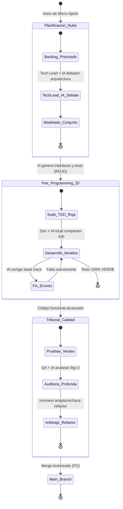
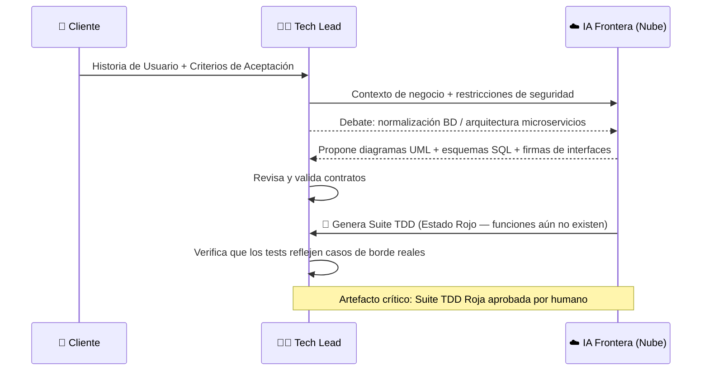
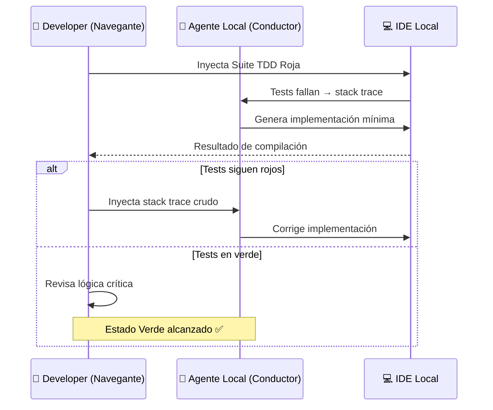

# 🔄 Ciclo de Vida H-AXP: Micro-Sprints y Ceremonias

---

## Arquitectura Temporal: el Micro-Sprint

H-AXP reemplaza el ciclo de 2 a 4 semanas por **Micro-Sprints de ejecución rápida**:

| Atributo | Valor |
|---|---|
| **Duración** | 3 a 7 días calendario |
| **Alcance** | Un componente funcional aislable |
| **Definition of Done (DoD)** | Código compila · Tests 100% verde · Auditoría algorítmica validada · Merge autorizado por humano |

Al introducir agentes autónomos que procesan lógica a la velocidad del hardware, el modelo H-AXP comprime radicalmente la temporalidad de las iteraciones, transformando los *Sprints* tradicionales en **Micro-Sprints** continuos orientados a componentes atómicos.

---

## Diagrama de Estados del Micro-Sprint

---

## Las Cuatro Ceremonias de Co-Creación

Las ceremonias ya no son traspasos asíncronos (*hand-offs*) en frío, sino **talleres de trabajo en tiempo real** donde el humano dirige la intuición y la estrategia, mientras la IA despliega su capacidad de procesamiento y estructuración.

---

### 1. 🗺️ Sprint Planning (Nodo Arquitectónico)

**Propósito:** Traducir las necesidades de negocio en contratos técnicos inmutables antes de escribir una sola línea de lógica.

**Dinámica de la sesión:**

**Artefacto de salida:** Suite de Pruebas Unitarias en **Estado Rojo** + contratos de interfaz.

---

### 2. ⚙️ Sprint Daily (Nodo Táctico — Pair Programming 2.0)

**Propósito:** Codificación iterativa de fuerza bruta con fricción económica cero (cero consumo de tokens comerciales).

**Roles en sesión:**

| Rol | Actor | Responsabilidad |
|---|---|---|
| **Navegante** | Humano (Developer) | Define estrategia algorítmica, inyecta tests fallidos, vigila estructura |
| **Conductor** | Agente Local (IA) | Autocompleta bloques de lógica, lee stack traces, corrige sintaxis en segundos |

---

### 3. 🔍 Tribunal de Calidad (Nodo de Calidad)

**Propósito:** Aplicar la rigurosidad de Extreme Programming (Diseño Simple, DRY, SOLID) sobre el código ya funcional.

**Dinámica:**
1. El código funcional (Verde) se somete a revisión. El Revisor humano invoca al Agente de Razonamiento asíncrono.
2. La IA genera un análisis profundo detectando cuellos de botella de Big O (complejidad temporal/espacial) o fugas de memoria, proponiendo un *diff* de refactorización.
3. El humano **arbitra**: decide si acepta la refactorización profunda para evitar deuda técnica, o si rechaza el cambio por considerarlo sobreingeniería innecesaria.

> ⚠️ **Barrera de Inmutabilidad:** El código refactorizado **no debe romper** las pruebas iniciales.

---

### 4. 📊 Sprint Review y Retrospectiva Paramétrica (Nodo de Producto)

**Review:**
El humano PO presenta el incremento funcional a los *stakeholders* para validación empírica en un entorno de *staging*.

**Retrospectiva Técnica (exclusiva de H-AXP):**
A diferencia de SCRUM tradicional, la retrospectiva H-AXP se centra en **calibrar el entorno**:

| Elemento a Calibrar | Acción |
|---|---|
| Ventanas de contexto (CWO) | Ajustar longitud de contexto inyectado por nodo |
| System Prompts con alucinaciones | Refinar restricciones axiómaticas |
| Atajos del IDE | Optimizar shortcuts de autocompletado |
| Recursos computacionales | Ajustar cuantización del modelo local |

---

← [Anterior: Fundamentos y Topología](04-fundamentos-topologia.md) | [Siguiente: Prácticas de Ingeniería →](06-practicas-tdd-zero-token.md)
