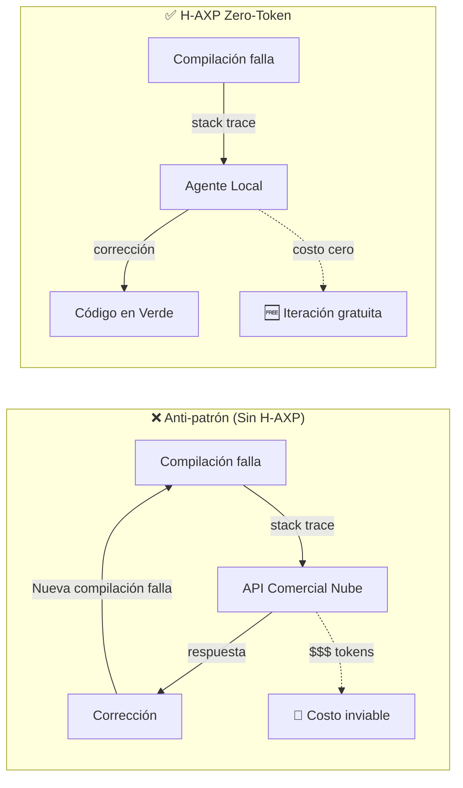
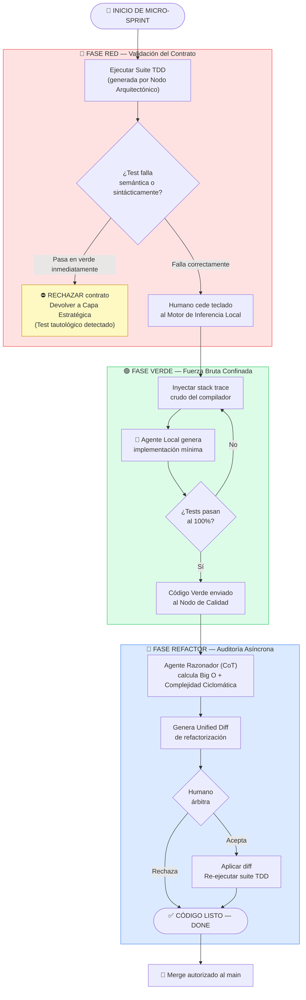

# 🧪 Prácticas de Ingeniería y TDD Zero-Token

---

## El Problema del Código Espagueti Acelerado

La adopción de inteligencia artificial en la ingeniería de software a menudo conduce al fenómeno del *código espagueti acelerado*: la capacidad de generar miles de líneas de código por minuto **sin una red de seguridad estructural**. Para contrarrestar esto, H-AXP eleva el **Test-Driven Development (TDD)** de una recomendación a un axioma inquebrantable.

En el paradigma H-AXP (Equipos Humano + IA), el ciclo *Red-Green-Refactor* de Kent Beck se transforma en un proceso de **TDD Zero-Token**, aislando el costo computacional de la iteración en el hardware local y garantizando que el diseño del sistema permanezca inmutable frente a las alucinaciones de la IA.

---

## Filosofía Zero-Token

El principio *Zero-Token* establece que la resolución de errores de compilación, sintaxis o lógica táctica **nunca debe consumir cuotas de APIs comerciales en la nube**.

> 💡 Enviar cada `stack trace` o `NullReferenceException` a un modelo de frontera en la nube (Capa Estratégica) genera un desperdicio masivo de recursos financieros y ancho de banda. H-AXP confina este bucle ruidoso a la **Capa de Ejecución (Local)**, permitiendo que el Agente Táctico itere a fuerza bruta, a costo cero y con latencia de milisegundos en el IDE del desarrollador.



---

## Ejecución del Ciclo Red-Green-Refactor H-AXP

El flujo de trabajo dentro del IDE local exige una estricta disciplina secuencial. **Alterar este orden destruye la garantía de calidad del framework.**



---

## Las Dos Barreras de Calidad

### 🛡️ Barrera 1: Prevención de Tautología (Fase RED)

El riesgo inherente de los LLMs es generar pruebas tautológicas (ej. `assert(true == true)`) o *mocks* mal configurados que siempre aprueban. Por lo tanto, la Fase RED exige que el desarrollador humano ejecute el test en su máquina **antes** de escribir la implementación. El test debe arrojar:

- Un **error semántico** (falla de aserción), o
- Un **error sintáctico** (clase no encontrada)

Si el test pasa a verde inmediatamente, el humano debe rechazar el contrato y devolverlo a la Capa Estratégica.

### 🛡️ Barrera 2: Inmutabilidad del Comportamiento (Fase REFACTOR)

Si el parche propuesto por la IA **rompe el test**, se descarta automáticamente y se vuelve al estado Verde anterior. El código refactorizado debe pasar la misma suite de pruebas sin modificarla.

---

## Técnica Clave: Inyección Directa de Stack Traces

La técnica clave de la Fase Verde es la **inyección directa de *stack traces***. Si el código generado falla, el humano **no describe el error conversacionalmente**; copia la salida bruta del compilador o del motor de pruebas (ej. JUnit, Jest) y la inyecta como contexto para el siguiente intento.

```
# Ejemplo de inyección correcta (Fase Verde)

<Stack_Trace>
FAIL: test_user_registration_with_duplicate_email
  AssertionError: Expected UserAlreadyExistsException but got None
  at UserService.register (UserService.java:45)
  at UserServiceTest.test_user_registration_with_duplicate_email (UserServiceTest.java:23)
</Stack_Trace>

<Target_Interface>
interface UserService {
    UserDTO register(RegisterDTO dto) throws UserAlreadyExistsException;
}
</Target_Interface>
```

Como este procesamiento ocurre en el hardware local (Capa de Ejecución), el equipo puede permitirse **decenas de iteraciones por minuto** sin consumir cuotas de API externas.

---

← [Anterior: Ciclo de Vida](05-ciclo-de-vida.md) | [Siguiente: Gobernanza de Contexto →](07-gobernanza-contexto.md)
