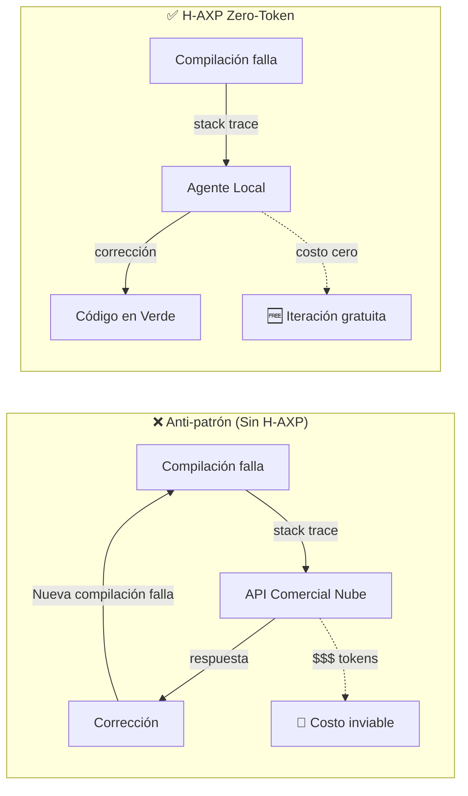

# 🧪 Prácticas de Ingeniería y TDD Zero-Token

---

## El Problema del Código Espagueti Acelerado

La adopción de inteligencia artificial en la ingeniería de software a menudo conduce al fenómeno del *código espagueti acelerado*: la capacidad de generar miles de líneas de código por minuto **sin una red de seguridad estructural**. Para contrarrestar esto, H-AXP eleva el **Test-Driven Development (TDD)** de una recomendación a un axioma inquebrantable.

En el paradigma H-AXP (Equipos Humano + IA), el ciclo *Red-Green-Refactor* de Kent Beck se transforma en un proceso de **TDD Zero-Token**, aislando el costo computacional de la iteración en el hardware local y garantizando que el diseño del sistema permanezca inmutable frente a las alucinaciones de la IA.

---

## Filosofía Zero-Token

El principio *Zero-Token* establece que la resolución de errores de compilación, sintaxis o lógica táctica **nunca debe consumir cuotas de APIs comerciales en la nube**.

> 💡 Enviar cada `stack trace` o `NullReferenceException` a un modelo de frontera en la nube (Capa Estratégica) genera un desperdicio masivo de recursos financieros y ancho de banda. H-AXP confina este bucle ruidoso a la **Capa de Ejecución (Local)**, permitiendo que el Agente Táctico itere a fuerza bruta, a costo cero y con latencia de milisegundos en el IDE del desarrollador.



---

## Ejecución del Ciclo Red-Green-Refactor H-AXP (v2.0)

El flujo de trabajo dentro del IDE local exige una estricta disciplina secuencial de tres fases correlativas (1, 2 y 3). **Alterar este orden destruye la garantía de calidad del framework:**

1. **Fase RED (Validación Empírica del Contrato y Stub Canónico):**
   El desarrollador descarga la interfaz, el esqueleto compilable (*Canonical Stub*) y la suite TDD pública. Verifica que el proyecto compile limpiamente y que la prueba falle estrictamente por excepción de stub o aserción.
2. **Fase VERDE (Fuerza Bruta Confinada y Generalización Algorítmica):**
   El agente local sustituye los stubs por lógica algorítmica general sin modificar contratos ni recurrir a tablas de búsqueda estáticas (*reward hacking*). El ciclo concluye cuando la suite pública y la suite sombra pasan al 100%.
3. **Fase REFACTOR (Auditoría Asíncrona y Diseño Simple):**
   El código en verde se traslada como archivo aislado al Nodo de Calidad en frío (*State Wiping*). La IA analiza complejidades ($\mathcal{M} \le 10$, $\mathcal{C}_{cog} \le 12$) y emite bloques deterministas de refactorización.

```mermaid
flowchart TD
    INICIO([🚀 INICIO DE MICRO-SPRINT]) --> RED

    subgraph FASE_RED["🔴 1. FASE RED — Validación Empírica del Contrato"]
        RED["Compilar Interfaces + Canonical Stub\n+ Public TDD Suite"]
        RED --> VERIF{¿Compila al 100% y falla\npor AssertionError o Stub?}
        VERIF -->|Pasa en verde / Tautología| RECHAZAR["⛔ RECHAZAR contrato\nFalso positivo detectado\nDevolver a Nodo Arquitectónico"]
        VERIF -->|Falla de compilación| STUB_ERR["⛔ RECHAZAR: Falta Stub Canónico\nNo admitir error sintáctico"]
        VERIF -->|Falla por aserción/stub| VERDE
    end

    subgraph FASE_VERDE["🟢 2. FASE VERDE — Fuerza Bruta Confinada"]
        VERDE["Humano cede teclado al Motor Local\nProhibido Hardcoding / Reward Hacking"]
        VERDE --> INYECTAR["Inyectar stack trace crudo de stderr"]
        INYECTAR --> AGENTE["🤖 Agente Local genera\nimplementación algorítmica general"]
        AGENTE --> PRUEBA{¿Public TDD Suite\n100% Verde?}
        PRUEBA -->|No| INYECTAR
        PRUEBA -->|Sí| SHADOW{¿Shadow Validation Suite\n100% Verde?}
        SHADOW -->|Falla: Overfitting| INYECTAR
        SHADOW -->|Pasa: Generalizado| REFACTOR
    end

    subgraph FASE_REFACTOR["🔵 3. FASE REFACTOR — Auditoría Asíncrona"]
        REFACTOR["Código Verde enviado al Nodo de Calidad\n(Limpieza de historial - State Wiping)"]
        REFACTOR --> COT["Agente Razonador (CoT) calcula:\nBig O · McCabe M <= 10 · C_cog <= 12"]
        COT --> DIFF["Genera bloques deterministas\nSEARCH / REPLACE"]
        DIFF --> ARBITRO{Humano árbitra(HATR <= 25%)}
        ARBITRO -->|Acepta| APLICAR["Aplicar parche SEARCH/REPLACE\nRe-ejecutar suites TDD"]
        ARBITRO -->|Rechaza| DONE
        APLICAR --> DONE
    end

    DONE([✅ CÓDIGO LISTO — DONE]) --> MERGE["🌿 Merge autorizado al main"]

    style FASE_RED fill:#fee2e2,stroke:#ef4444
    style FASE_VERDE fill:#dcfce7,stroke:#22c55e
    style FASE_REFACTOR fill:#dbeafe,stroke:#3b82f6
    style RECHAZAR fill:#fef9c3,stroke:#ca8a04
    style STUB_ERR fill:#fef9c3,stroke:#ca8a04
```

---

## Las Dos Barreras de Calidad y el Stubbing Canónico

### 🛡️ Barrera 1: Prevención de Tautología y Regla de Stubbing Canónico (Fase RED)

Enfoques ingenuos admiten que un test falle en Fase RED por un error sintáctico (ej. `ClassNotFoundException` porque la clase aún no ha sido creada). **Esto invalida por completo la prevención de tautologías:** un test que contiene una tautología (`assert(true == true)`) o un *mock* auto-afirmativo también fallará si la clase no existe; tan pronto como el agente cree la clase vacía, el test pasará a verde sin probar nada.

**Regla de Stubbing Canónico:**
1. El Nodo Arquitectónico debe emitir la interfaz junto con su **Esqueleto Compilable (*Canonical Stub*)**, donde cada método lanza explícitamente `UnsupportedOperationException("H-AXP Red State Stub")` o `NotImplementedException`.
2. **Criterio Estricto de Fase RED:** *Un contrato solo es válido en Fase RED si el proyecto compila al 100% sin advertencias sintácticas y el test runner falla exclusivamente por la excepción del stub o por una aserción no satisfecha.*

### 🛡️ Barrera 2: Inmutabilidad del Comportamiento (Fase REFACTOR)

Si el bloque de refactorización propuesto por la IA **rompe cualquier aserción de la suite pública o sombra**, se descarta inmediatamente y se restaura el estado Verde previo.

---

## Mitigación de Vulnerabilidades Críticas en Generación de Código

### 1. Prevención del Fenómeno de *Reward Hacking* (Sobreajuste al Test)
Cuando el Nodo Táctico opera bajo aislamiento estricto y la directiva de "mínima sintaxis viable", los modelos locales tienden a generar tablas estáticas de búsqueda condicional (`if (input == X) return Y;`) para satisfacer los tests sin generalizar la regla de negocio.

H-AXP resuelve esto mediante un **Doble Anillo de Validación**:
* **Triangulación mediante *Property-Based Testing (PBT)*:** La suite de pruebas incluye aserciones basadas en propiedades e invariantes algebraicas evaluadas sobre generadores aleatorios (ej. `Hypothesis` en Python, `fast-check` en TypeScript, `jqwik` en Java).
* **Arquitectura de Pruebas de Caja Negra (*Public vs. Shadow Suites*):**
  * `<Public_TDD_Suite>`: Inyectada al agente local para guiar el ciclo.
  * `<Shadow_Validation_Suite>`: Aislada en una carpeta protegida y ejecutada automáticamente por el guardián de *pre-commit* con valores de entrada ortogonales.

### 2. Frontera de Determinismo y Arquitectura Hexagonal
El bucle iterativo *Zero-Token* asume determinismo puro y ejecución en milisegundos:
$$\text{Evaluar}(\text{Código}, \text{Test}) \rightarrow \{\text{Verde}, \text{StackTrace Determinista}\}$$

Para que este modelo no colapse frente a operaciones complejas de red o bases de datos, H-AXP prescribe estructurar el código bajo **Arquitectura Hexagonal (Ports & Adapters)**:
* **Núcleo de Dominio y Casos de Uso:** 100% determinista, en memoria, desacoplado de dependencias externas. Itera con máxima aceleración *Zero-Token*.
* **Adaptadores de Infraestructura (DB, APIs, UI):** Validados mediante pruebas de contrato (*Contract Testing*) o contenedores efímeros (*Testcontainers*), permitiendo inyectar fragmentos de documentación técnica puntual vía RAG local liviano para evitar alucinaciones en SDKs externos.

---

## Técnica Clave: Inyección Directa de Stack Traces

La técnica clave de la Fase Verde es la **inyección directa de *stack traces***. Si el código generado falla, el humano **no describe el error conversacionalmente**; copia la salida bruta del compilador o del motor de pruebas (ej. JUnit, Jest, PyTest) y la inyecta como contexto para el siguiente intento.

```
# Ejemplo de inyección correcta (Fase Verde)

<Stack_Trace>
FAIL: test_user_registration_with_duplicate_email
  AssertionError: Expected UserAlreadyExistsException but got None
  at UserService.register (UserService.java:45)
  at UserServiceTest.test_user_registration_with_duplicate_email (UserServiceTest.java:23)
</Stack_Trace>

<Target_Interface_And_Stub>
interface UserService {
    UserDTO register(RegisterDTO dto) throws UserAlreadyExistsException;
}

class UserServiceStub implements UserService {
    public UserDTO register(RegisterDTO dto) throws UserAlreadyExistsException {
        throw new UnsupportedOperationException("H-AXP Red State Stub");
    }
}
</Target_Interface_And_Stub>
```

Como este procesamiento ocurre en el hardware local (Capa de Ejecución), el equipo puede permitirse **decenas de iteraciones por minuto** sin consumir cuotas de API externas.

---

← [Anterior: Ciclo de Vida](05-ciclo-de-vida.md) | [Siguiente: Gobernanza de Contexto →](07-gobernanza-contexto.md)
