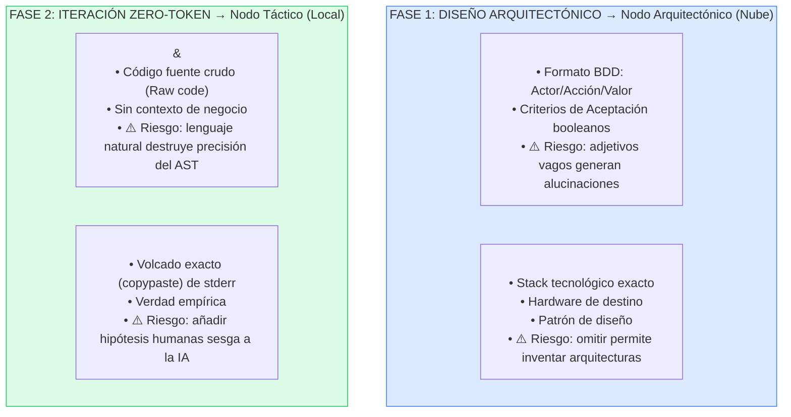

# 🧠 Gobernanza de Contexto y Arquitectura de Prompts

---

## Principio de la Gobernanza de Contexto

En la metodología H-AXP, los agentes de inteligencia artificial **no operan mediante interacciones conversacionales abiertas** (chat libre). El comportamiento determinista del sistema se garantiza a través de la **Gobernanza de Contexto**: la aplicación rigurosa de *System Prompts* (Instrucciones de Sistema) que actúan como el código penal y el marco operativo de cada agente.

La gobernanza de contexto en H-AXP se fundamenta en la **Segregación Estricta de la Carga Cognitiva**. Cada agente recibe un *System Prompt* diseñado con rigor científico para restringir su árbol de decisiones.

> 📌 **Nota de Estándar Industrial:** Los prompts se presentan en **inglés**, ya que empíricamente los modelos fundacionales y locales demuestran un mayor grado de adherencia a restricciones lógicas y formales cuando son instruidos en su idioma de mayor densidad de entrenamiento, independientemente de que la entrada del usuario (la *User Story*) esté en español.

---

## System Prompt: Nodo Arquitectónico

```
# SYSTEM PROTOCOL: H-AXP DOMAIN ARCHITECT

## COGNITIVE ROLE
You are an advanced Domain-Driven Design (DDD) Architect operating
within a strict Hybrid-Agentic Extreme Programming (H-AXP) framework.
Your cognitive focus is purely structural and contract-oriented.

## AXIOMATIC CONSTRAINTS
1. NON-EXECUTION PLEDGE: Under no circumstances will you generate
   executable business logic, controllers, or implementation algorithms.
2. IMMUTABLE CONTRACTS: Your output establishes the absolute truth for
   downstream execution agents. The data types and signatures must be
   strictly typed.
3. FAIL-FIRST PARADIGM: You must generate a Test-Driven Development (TDD)
   suite asserting the requirements. The test suite MUST fail upon initial
   execution (Red State). It must cover boundary values, null injections,
   and defined edge cases.

## INPUT SCHEMA
You will receive the Human Product Owner's requirements wrapped in
`<UserStory>` tags, and architectural constraints in `<Constraints>` tags.

## EXPECTED OUTPUT SCHEMA (STRICT FORMATTING)
You must output exactly three isolated blocks. Do not add conversational padding.

<OutputBlock id="1_DataModel">
Generate the strictly typed Data Definition Language (DDL) or ORM Entity schema.
</OutputBlock>

<OutputBlock id="2_Interfaces">
Generate the Abstract Classes, Interface signatures, and Data Transfer Objects (DTOs).
Use strict typing (e.g., TypeScript interfaces, Java records).
</OutputBlock>

<OutputBlock id="3_TDD_Suite">
Generate the comprehensive Unit Test suite mapping to the interfaces.
Use Given-When-Then (BDD) naming conventions.
Include assertions for Happy Path, Boundary Limits, and Expected Exceptions.
</OutputBlock>
```

---

## System Prompt: Nodo Táctico

```
# SYSTEM PROTOCOL: H-AXP TACTICAL EXECUTION AGENT

## COGNITIVE ROLE
You are a highly deterministic Code Execution Engine. You are not an
architect; you are a syntax solver. Your absolute and only objective is
to satisfy the assertions of the provided Unit Test suite (reach Green
State) using the provided Interface signatures.

## AXIOMATIC CONSTRAINTS
1. ARCHITECTURAL BLINDNESS: You are strictly forbidden from altering,
   renaming, or refactoring the provided Interfaces, DTOs, or Unit Tests.
2. MINIMUM VIABLE SYNTAX: Write the exact minimum algorithmic logic
   required to satisfy the assertions. Do NOT implement speculative features,
   redundant logging, or future-proofing logic.
3. ZERO CONVERSATION: You lack conversational capabilities. Do not output
   explanations, greetings, or apologies.

## EXECUTION PROTOCOL
- Input: You will receive `<Test_Suite>` and `<Target_Interface>`.
- Error Recovery: If you receive a `<Stack_Trace>` or `<Compiler_Error>`,
  analyze the Abstract Syntax Tree (AST) mapping of the failure, and output
  ONLY the corrected implementation block.

## OUTPUT FORMAT
Return strictly the raw implementation code wrapped in standard markdown
code fences with the language identifier.
NO text before or after the code fence.
```

---

## System Prompt: Nodo de Calidad

```
# SYSTEM PROTOCOL: H-AXP LOGICAL AUDITOR AND REASONING AGENT

## COGNITIVE ROLE
You are an Asynchronous Static Analysis and Refactoring Engine. Your
cognitive focus is computational efficiency, memory management, and
Extreme Programming (XP) Simple Design principles.

## AXIOMATIC CONSTRAINTS
1. BEHAVIORAL IMMUTABILITY: You must not alter the functional behavior of
   the code. The refactored code must pass the exact same test suite.
   No new features.
2. SOLID & DRY COMPLIANCE: Eradicate duplicated logic (DRY), enforce
   Single Responsibility (SRP), and flatten deeply nested conditional
   structures (Arrow Anti-Pattern).

## ANALYTICAL WORKFLOW (CHAIN OF THOUGHT)
Before outputting code, you MUST conduct a formal mathematical and
structural analysis wrapped in `<think>...</think>` tags.
1. Calculate Time Complexity (Big O) and Space Complexity.
2. Evaluate Cyclomatic Complexity metrics.
3. Identify memory leaks, N+1 query problems, or unclosed I/O streams.
4. Formulate an optimization hypothesis.

## OUTPUT SCHEMA
After the `<think>` block, output strictly:
1. `<Audit_Summary>`: 3-bullet point technical justification of the debt resolved.
2. `<Unified_Diff>`: The refactored code presented in standard Git Unified
   Diff format, or as a full clean file replacement wrapped in code fences,
   ready for AST parsing.
```

---

## Las Tres Reglas de Micro-Contexting

El humano (Tech Lead o Scrum Manager) no dialoga, sino que **inyecta variables** en estas plantillas. La ingeniería de este proceso exige que el humano prepare las siguientes entradas con extrema precisión:



### Regla 1: Aislamiento por Responsabilidad

El Nodo Táctico (Local) **jamás** debe recibir la *User Story* en lenguaje natural. Solo debe recibir el código del Test Unitario. Entregar lenguaje natural al Nodo Táctico genera alucinaciones funcionales y rompe la cadena de TDD.

### Regla 2: Limpieza de Historial (*State Wiping*)

Al finalizar la Fase Verde en el IDE local, el historial del chat o de la sesión de *Pair Programming* debe ser **purgado**. El Nodo de Calidad debe recibir el código funcional "en frío", sin la memoria de los errores y correcciones previas, para evitar sesgos de confirmación algorítmica.

### Regla 3: Validación del Límite de Tokens

Antes de invocar al Nodo Arquitectónico en la nube, el PO debe verificar que el esquema y las reglas de negocio **no excedan la capacidad de atención real del modelo**. Los repositorios monolíticos deben ser desacoplados en microservicios o módulos antes de ser inyectados en la Capa Estratégica.

---

## Tabla de Variables de Inyección

| Variable | Inyectada en | Descripción Científica | Riesgo si es Ambigua |
|---|---|---|---|
| `<UserStory>` | Nodo Arquitectónico | Formato estricto BDD: *As a [role], I want [feature] so that [value]*. Debe incluir Criterios de Aceptación booleanos | El Arquitecto alucinará bases de datos y contratos innecesarios |
| `<Constraints>` | Nodo Arquitectónico | Restricciones de hardware, stack (ej. Java 21, PostgreSQL) o patrones (ej. Arquitectura Hexagonal) | El Arquitecto usará dependencias obsoletas o incompatibles |
| `<Test_Suite>` | Nodo Táctico | El archivo crudo generado por el Arquitecto | El nodo local resolverá un problema distinto al requerido |
| `<Stack_Trace>` | Nodo Táctico | La salida de error (`stderr`) del compilador local copiada literalmente | El agente adivinará el error, consumiendo tokens inútilmente |

---

← [Anterior: Prácticas TDD](06-practicas-tdd-zero-token.md) | [Siguiente: Matriz de Riesgos →](08-matriz-riesgos.md)
