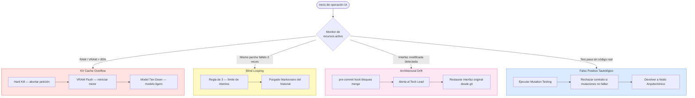

# ⚠️ Matriz de Riesgos, Degradación y Mecanismo de Fallback

---

## El Problema de la Degradación Estocástica

La integración de Modelos de Lenguaje Grande (LLMs) en el núcleo operativo del desarrollo de software introduce vectores de fallo no deterministas. A diferencia de un compilador tradicional que falla de manera binaria y predecible, los agentes de IA pueden sufrir **degradación estocástica**, produciendo código sintácticamente válido pero lógicamente erróneo, o consumiendo recursos de hardware hasta paralizar la estación de trabajo.

---

## Matriz de Riesgos Operativos (H-AXP Risk Matrix)

| Vector de Riesgo | Naturaleza | Síntoma Clínico | Estrategia de Mitigación |
|---|---|---|---|
| **Desbordamiento de KV Cache** (*Memory Swap Death*) | Hardware | Caída drástica de velocidad de inferencia (tokens por segundo), sobrecalentamiento del disco, sistema operativo congelado | Bloqueo estricto del límite de contexto (*Context Window Occupancy*) acorde a la memoria física disponible. Uso de cuantización de pesos (ej. 4-bit / 8-bit) |
| **Oscilación Bimodal** (*Blind Looping*) | Algorítmica | El Agente Táctico propone el Parche A; el parche falla. Propone el Parche B; falla y vuelve a proponer el Parche A de forma cíclica | Protocolo de Límite de Intentos (Regla de 3). Purgado Markoviano (limpiar historial de sesión) tras el segundo fallo consecutivo |
| **Deriva Arquitectónica** (*Architectural Drift*) | Arquitectura | El Agente Local modifica las firmas de las interfaces o los tipos de variables para forzar el paso del test, ignorando el diseño | *Git Hook* de `pre-commit` que bloquea la fusión si se detectan mutaciones en los archivos de interfaz o esquemas de base de datos protegidos |
| **Falsos Positivos Tautológicos** | Calidad / QA | Las pruebas pasan en verde independientemente de la lógica inyectada (ej. *mocks* mal implementados que sobreescriben el flujo real) | Obligatoriedad estricta de la "Fase Roja Empírica" en el IDE. Implementación periódica de *Mutation Testing* automatizado |

---

## Diagrama de Flujo de la Matriz de Riesgos



---

## Protocolo de Contingencia de Hardware (OOM — Out Of Memory)

Cuando la ventana de contexto de un modelo local crece, la memoria requerida (KV Cache) aumenta exponencialmente. Si el motor de inferencia local excede la memoria física disponible (VRAM en GPUs dedicadas o RAM en sistemas compartidos), el sistema operativo recurre al paginado (*Swap*) en el disco de almacenamiento, destruyendo la latencia operativa.

```
CANVAS 5.2: PROTOCOLO DE CONTINGENCIA DE HARDWARE (OOM)

[ TRIGGER: Latencia extrema (TTFT > 5s) | SO Congelado | Disparo de Swap SSD ]
              │
              ▼
┌─────────────────────────────────────────────────────────────┐
│ 1. HARD KILL (Aborto Inmediato)                             │
│    Acción: Cancelar la petición en el IDE/Terminal          │
│    Motivo: Evitar el colapso del Kernel del SO por RAM      │
└─────────────────────────────────────────────────────────────┘
              │
              ▼
┌─────────────────────────────────────────────────────────────┐
│ 2. VRAM FLUSH (Liberación de Memoria)                       │
│    Acción: Reiniciar el motor de inferencia local           │
│            (vLLM, Ollama, LM Studio)                        │
│    Motivo: Vaciar los tensores atascados y limpiar          │
│            la paginación de memoria                         │
└─────────────────────────────────────────────────────────────┘
              │
              ▼
┌─────────────────────────────────────────────────────────────┐
│ 3. MODEL TIER-DOWN (Degradación Estratégica)                │
│    Acción: Suspender Modelo Primario (7B-14B)               │
│            → Activar Modelo Ligero (3B)                     │
│    Motivo: Mantener el flujo de trabajo cuando el IDE o     │
│            Docker exigen demasiada RAM, compensando con      │
│            un aislamiento de contexto más estricto          │
└─────────────────────────────────────────────────────────────┘
```

---

## Git Hook de Protección Arquitectónica

Para implementar la protección contra Deriva Arquitectónica, se recomienda el siguiente `pre-commit` hook:

```bash
#!/bin/bash
# .git/hooks/pre-commit
# Protección H-AXP: bloquear mutaciones en contratos inmutables

PROTECTED_DIRS=("src/interfaces" "src/domain/contracts" "db/migrations")
STAGED_FILES=$(git diff --cached --name-only)

for DIR in "${PROTECTED_DIRS[@]}"; do
    if echo "$STAGED_FILES" | grep -q "^$DIR/"; then
        echo "🚨 H-AXP DRIFT GUARD: Mutación detectada en '$DIR'"
        echo "   Los contratos de interfaz son inmutables."
        echo "   Solicitar aprobación del Tech Lead antes de proceder."
        exit 1
    fi
done

echo "✅ H-AXP: Verificación de integridad arquitectónica pasada."
exit 0
```

---

← [Anterior: Gobernanza de Contexto](07-gobernanza-contexto.md) | [Siguiente: Ética y Propiedad Intelectual →](09-etica-propiedad-intelectual.md)
