# ⚠️ Matriz de Riesgos, Degradación y Mecanismo de Fallback

---

## El Problema de la Degradación Estocástica

La integración de Modelos de Lenguaje Grande (LLMs) en el núcleo operativo del desarrollo de software introduce vectores de fallo no deterministas. A diferencia de un compilador tradicional que falla de manera binaria y predecible, los agentes de IA pueden sufrir **degradación estocástica**, produciendo código sintácticamente válido pero lógicamente erróneo, o consumiendo recursos de hardware hasta paralizar la estación de trabajo.

---

## Matriz de Riesgos Operativos (H-AXP Risk Matrix v2.0)

| Vector de Riesgo | Naturaleza | Síntoma Clínico | Estrategia de Mitigación |
|---|---|---|---|
| **Desbordamiento de KV Cache** (*Memory Swap Death*) | Hardware | Caída drástica de velocidad de inferencia (tokens por segundo), sobrecalentamiento del disco, sistema operativo congelado | Bloqueo estricto del límite de contexto (*Context Window Occupancy*) acorde a la memoria física disponible. Uso de cuantización de pesos (ej. 4-bit / 8-bit) y *AST Method Slicing* |
| **Oscilación Bimodal** (*Blind Looping*) | Algorítmica | El Agente Táctico propone el Parche A; el parche falla. Propone el Parche B; falla y vuelve a proponer el Parche A de forma cíclica | Protocolo de Límite de Intentos (Regla de 3). Purgado Markoviano (limpiar historial de sesión) tras el segundo fallo consecutivo y Protocolo CEP |
| **Deriva Arquitectónica** (*Architectural Drift*) | Arquitectura | El Agente Local modifica las firmas de las interfaces o los tipos de variables para forzar el paso del test, ignorando el diseño | *Git Hook* determinista de `pre-commit` que valida el hash criptográfico SHA-256 de contratos inmutables ($CMR = 0\%$) |
| **Falsos Positivos Tautológicos** | Calidad / QA | Las pruebas pasan en verde independientemente de la lógica inyectada (ej. *mocks* mal implementados que sobreescriben el flujo real) | Obligatoriedad estricta de la "Fase Roja Empírica" con *Canonical Stubs*. Implementación de *Mutation Testing* ($MS \ge 85\%$) |
| **Reward Hacking** (*Sobreajuste al Test*) | Cognitiva / Síntesis | El modelo genera tablas de búsqueda estáticas (`if/else` con literales de prueba) para satisfacer la suite sin implementar el algoritmo | Doble anillo de validación: *Property-Based Testing (PBT)* y ejecución oculta de la *Shadow Validation Suite* |

---

## Diagrama de Flujo de la Matriz de Riesgos

```mermaid
flowchart TD
    INICIO([Inicio de operación IA]) --> MONITOR{Monitor de\nrecursos activo}

    MONITOR -->|RAM / VRAM > 85%| OOM
    MONITOR -->|Mismo parche fallido 2 veces| LOOP
    MONITOR -->|Interfaz modificada detectada| DRIFT
    MONITOR -->|Test pasa sin código real| TAUT
    MONITOR -->|Hardcoding de constantes| HACK

    subgraph OOM["KV Cache Overflow"]
        OOM1[Hard Kill — abortar petición]
        OOM2[VRAM Flush — reiniciar motor]
        OOM3[Model Tier-Down 3B + AST Slicing]
        OOM1 --> OOM2 --> OOM3
    end

    subgraph LOOP["Blind Looping"]
        L1[Regla de 3 — límite de intentos]
        L2[Purgado Markoviano del historial]
        L3[Escalado de Contrato CEP]
        L1 --> L2 --> L3
    end

    subgraph DRIFT["Architectural Drift"]
        D1[pre-commit hook valida SHA-256]
        D2[CMR == 0% obligatorio]
        D3[Restaurar interfaces desde Git]
        D1 --> D2 --> D3
    end

    subgraph TAUT["Falso Positivo Tautológico"]
        T1[Requerir Canonical Stubs]
        T2[Ejecutar Mutation Testing MS >= 85%]
        T3[Devolver a Nodo Arquitectónico]
        T1 --> T2 --> T3
    end

    subgraph HACK["Reward Hacking"]
        H1[Property-Based Testing]
        H2[Ejecutar Shadow Validation Suite]
        H3[Rechazar commit por overfitting]
        H1 --> H2 --> H3
    end

    style OOM fill:#fee2e2,stroke:#ef4444
    style LOOP fill:#fef9c3,stroke:#ca8a04
    style DRIFT fill:#fce7f3,stroke:#ec4899
    style TAUT fill:#dbeafe,stroke:#3b82f6
    style HACK fill:#f3e8ff,stroke:#9333ea
```



---

## Protocolo de Contingencia de Hardware (OOM — Out Of Memory)

Cuando la ventana de contexto de un modelo local crece, la memoria requerida (KV Cache) aumenta exponencialmente. Si el motor de inferencia local excede la memoria física disponible (VRAM en GPUs dedicadas o RAM en sistemas compartidos), el sistema operativo recurre al paginado (*Swap*) en el disco de almacenamiento, destruyendo la latencia operativa.

```
CANVAS 5.2: PROTOCOLO DE CONTINGENCIA DE HARDWARE (OOM)

[ TRIGGER: Latencia extrema (TTFT > 5s) | SO Congelado | Disparo de Swap SSD ]
              │
              ▼
┌─────────────────────────────────────────────────────────────┐
│ 1. HARD KILL (Aborto Inmediato)                             │
│    Acción: Cancelar la petición en el IDE/Terminal          │
│    Motivo: Evitar el colapso del Kernel del SO por RAM      │
└─────────────────────────────────────────────────────────────┘
              │
              ▼
┌─────────────────────────────────────────────────────────────┐
│ 2. VRAM FLUSH (Liberación de Memoria)                       │
│    Acción: Reiniciar el motor de inferencia local           │
│            (vLLM, Ollama, LM Studio)                        │
│    Motivo: Vaciar los tensores atascados y limpiar          │
│            la paginación de memoria                         │
└─────────────────────────────────────────────────────────────┘
              │
              ▼
┌─────────────────────────────────────────────────────────────┐
│ 3. MODEL TIER-DOWN & AST METHOD SLICING                     │
│    Acción: Suspender Modelo Primario (7B-14B)               │
│            → Activar Modelo Ligero (3B) con AST Slicing     │
│    Motivo: Reducir contexto al aislar un único método y      │
│            un único test por iteración (reducción >75% KV)  │
└─────────────────────────────────────────────────────────────┘
```

### Protocolo de Degradación de Granularidad (*AST Method Slicing*)

La capacidad de un LLM para resolver restricciones simultáneas cae de forma no lineal cuando se reduce el conteo de parámetros de $14\text{B}$ a $3\text{B}$. Si a un modelo cuantizado de $3\text{B}$ se le inyecta una clase completa con múltiples métodos y un `<Stack_Trace>` con varias aserciones fallidas, su mecanismo de atención (*Self-Attention*) sufre interferencia cruzada, rompiendo un método cuando intenta arreglar otro.

**Regla Operativa de AST Method Slicing en Modo Tier-Down ($3\text{B}$):**
1. **Modo Micro-Foco (*Single-Assertion Isolation*):** Cuando el entorno conmuta al nivel 3B, el orquestador local extrae del árbol sintáctico (AST) **únicamente la firma de un (1) método** y **un (1) test unitario fallido** a la vez.
2. **Congelamiento Incremental (*Method Locking*):** Una vez que el método individual pasa su prueba en verde, su implementación queda congelada (*locked*) y se procede al siguiente método.
3. **Optimización de Memoria:** Este protocolo reduce la ocupación de la *KV Cache* en más de un $75\%$, permitiendo que un modelo de $3\text{B}$ mantenga una precisión de resolución equiparable a modelos de mayor escala.

---

## Anexo Técnico de Automatización: Git Hook Guardián (`pre-commit`)

Para garantizar la inmutabilidad de contratos ($CMR = 0\%$) y prevenir que código con sobreajuste o sobrecomplejidad llegue a la rama principal, se implementa el siguiente guardián determinista en `.git/hooks/pre-commit`:

```bash
#!/usr/bin/env bash
# ==============================================================================
# H-AXP DETERMINISTIC GATEKEEPER (Pre-Commit Hook v1.0)
# Garantiza: Contract Mutation Rate (CMR) == 0% y Ejecución de Shadow TDD Suite
# ==============================================================================

set -e

LOCK_FILE=".haxp/contract_manifest.sha256"
PROTECTED_DIRS=("src/domain/interfaces" "src/domain/dto" "db/schema" "tests/public_tdd")

echo "[H-AXP Gatekeeper] Iniciando verificación de integridad..."

# 1. BARRERA DE INMUTABILIDAD DE CONTRATOS (CMR == 0%)
if [ ! -f "$LOCK_FILE" ]; then
    echo "[ERROR CRÍTICO] No se encontró el manifiesto criptográfico del Nodo Arquitectónico ($LOCK_FILE)."
    echo "Ejecute 'haxp-cli lock-contracts' al finalizar el Sprint Planning."
    exit 1
fi

if ! sha256sum --status -c "$LOCK_FILE"; then
    echo "======================================================================"
    echo "[VIOLACIÓN AXIOMÁTICA H-AXP DETECTADA: DERIVA ARQUITECTÓNICA]"
    echo "El Nodo Táctico o el Desarrollador ha mutado un contrato protegido,"
    echo "una interfaz, un esquema DDL o la suite de pruebas original."
    echo "----------------------------------------------------------------------"
    sha256sum -c "$LOCK_FILE" | grep -v "OK$" || true
    echo "----------------------------------------------------------------------"
    echo "Acción requerida: Revierta los cambios en los archivos protegidos o"
    echo "inicie un Protocolo de Escalado de Contrato (CEP) con el Tech Lead."
    echo "======================================================================"
    exit 1
fi
echo "[OK] Soberanía de Contratos verificada (CMR = 0.0%)."

# 2. BARRERA EMPÍRICA: EJECUCIÓN DE SUITE PÚBLICA + SUITE SOMBRA (ANTI-OVERFITTING)
echo "[H-AXP Gatekeeper] Ejecutando Public TDD Suite y Shadow Validation Suite..."
if ! npm test -- --runInBand --silent; then
    echo "[BLOQUEO H-AXP] El código no satisface el 100% de las suites de validación."
    echo "El commit ha sido abortado. Regrese al Bucle Táctico Local."
    exit 1
fi
echo "[OK] Validación funcional y anti-overfitting superada al 100%."

# 3. BARRERA DE COMPLEJIDAD ALGORÍTMICA (M <= 10)
echo "[H-AXP Gatekeeper] Verificando umbral de Complejidad Ciclomática (McCabe <= 10)..."
if ! npx eslint "src/implementation/**/*" --rule 'complexity: ["error", 10]'; then
    echo "[BLOQUEO H-AXP] Complejidad Ciclomática superior al umbral permitido (M > 10)."
    echo "Invoque al Nodo de Calidad (Agente Razonador Local) para refactorizar."
    exit 1
fi
echo "[OK] Complejidad algorítmica dentro de los parámetros H-AXP."
echo "[H-AXP Gatekeeper] Commit autorizado."
exit 0
```

---

← [Anterior: Gobernanza de Contexto](07-gobernanza-contexto.md) | [Siguiente: Ética y Propiedad Intelectual →](09-etica-propiedad-intelectual.md)
