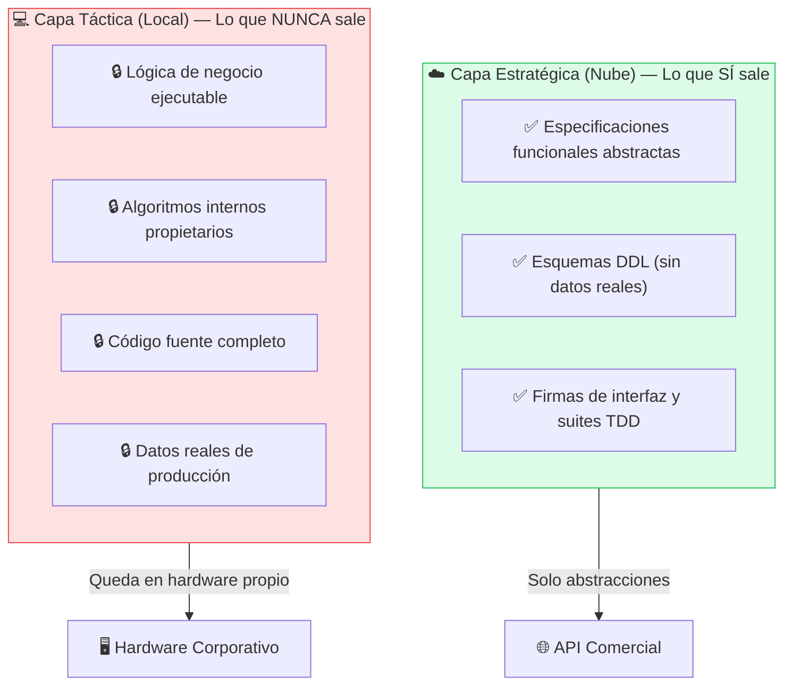
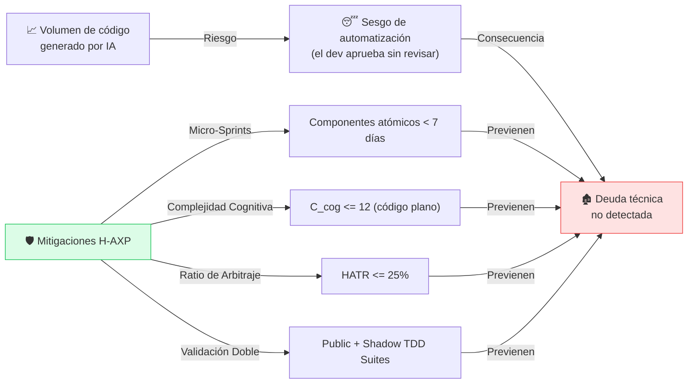

# ⚖️ Consideraciones Éticas y Propiedad Intelectual

---

La formalización industrial de H-AXP debe contemplar los aspectos regulatorios y operacionales asociados a la adopción de agentes inteligentes en entornos corporativos.

---

## Soberanía y Privacidad de la Información: Riesgo de Fuga Semántica (Semantic Leakage)

El desacoplamiento arquitectónico de H-AXP protege la propiedad intelectual de la organización mediante una separación explícita entre lo que viaja a servidores externos y lo que reside localmente:

### Protocolo de Ofuscación Ontológica (*Isomorphic Domain Mapping*)

En sectores altamente regulados (banca, defensa, salud), las reglas de negocio descritas en `<UserStory>` (ej. ponderaciones de un algoritmo de *scoring* crediticio o estructuras de balances propietarios) constituyen en sí mismas propiedad intelectual crítica. Para evitar la **Fuga Semántica (*Semantic Leakage*)**, H-AXP establece dos niveles de clasificación de confidencialidad:

1. **Nivel 1 (Estándar):** Historias de usuario y esquemas regulares enviados a la Capa Estratégica sin datos sensibles ni PII.
2. **Nivel 2 (Secreto Industrial — Isomórfico):**
   * El Tech Lead aplica una **transformación isomórfica** antes de la consulta a la nube: sustituye el vocabulario del negocio por un dominio abstracto equivalente (ej. transformar *"Comisión de Liquidación Interbancaria con Tasa Variable"* en *"Cálculo de Flujo de Fluidos en Nodos con Coeficiente Dinámico"*), conservando intactas las fórmulas matemáticas, tipos de datos y restricciones de borde.
   * Al descargar los contratos y tests de la nube, un diccionario de mapeo local (`domain-map.json`) revierte automáticamente las clases e interfaces al vocabulario real de la organización antes de iniciar la Fase Verde local.

---

## Responsabilidad Legal y Autoría del Código

Frente a los debates de derechos de autor y licencias de código abierto, H-AXP establece que el **Nodo Simbiótico** opera bajo el principio legal de **asistencia técnica**:

| Actor | Rol Legal |
|---|---|
| **Agentes de IA** | Herramientas de soporte a la compilación y síntesis de sintaxis |
| **Humano (Tech Lead / Developer)** | Autor legal. Responsable civil por fallos del sistema o infracciones de propiedad intelectual |

> La autoría legal y la responsabilidad civil por fallos del sistema o infracciones de propiedad intelectual recaen de manera ineludible en el **humano que arbitra y autoriza la integración (*merge*) del incremento funcional**.

---

## Deuda Técnica y Fatiga Cognitiva del Revisor

El incremento en el volumen de código generado por IA puede inducir el **sesgo de automatización** (el desarrollador aprueba *diffs* sin revisarlos críticamente). H-AXP mitiga este factor mediante métricas formales y límites estructurales:
* **Límite de Micro-Sprint:** Componentes atómicos terminables en 3 a 7 días.
* **Control de Arbitraje Humano:** El ratio $HATR \le 25\%$ garantiza que el humano dedique tiempo suficiente a la auditoría sin verse abrumado.
* **Complejidad Cognitiva Acotada ($\mathcal{C}_{cog} \le 12$):** Forzar código aplanado evita que el revisor humano deba descifrar jerarquías profundas de control de flujo.
* **Suites TDD Objetivas:** La combinación de `<Public_TDD_Suite>` y `<Shadow_Validation_Suite>` actúa como el único árbitro imparcial del comportamiento del sistema.

---

## Checklist de Cumplimiento Ético

Antes de cada Micro-Sprint, el Tech Lead debe verificar:

- [ ] ¿Las *User Stories* enviadas a la nube están desprovistas de datos sensibles o de producción?
- [ ] ¿Los esquemas DDL no contienen información de identificación personal (PII)?
- [ ] ¿Existe un registro de auditoría del agente de IA que generó cada bloque de código?
- [ ] ¿El humano ha revisado y autorizado explícitamente el merge al repositorio principal?
- [ ] ¿El código generado ha sido auditado frente a licencias de código abierto incompatibles?

---

← [Anterior: Matriz de Riesgos](08-matriz-riesgos.md) | [Siguiente: Conclusiones →](10-conclusiones.md)
