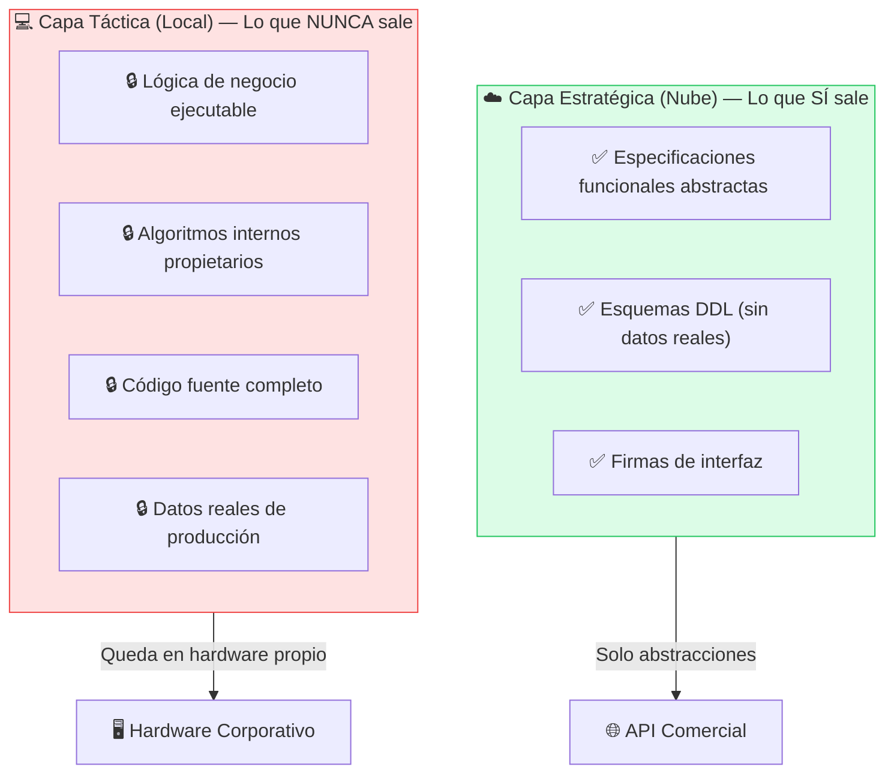
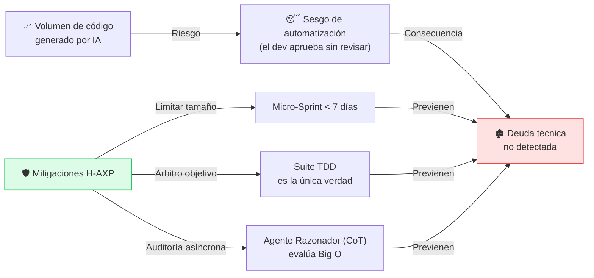

# ⚖️ Consideraciones Éticas y Propiedad Intelectual

---

La formalización industrial de H-AXP debe contemplar los aspectos regulatorios y operacionales asociados a la adopción de agentes inteligentes en entornos corporativos.

---

## Soberanía y Privacidad de la Información (Data Leakage)

El desacoplamiento arquitectónico de H-AXP protege la propiedad intelectual de la organización mediante una separación explícita de lo que viaja a servidores externos:

**Garantía clave:** Ninguna línea de código ejecutable con lógica de negocio propietaria se transmite a servidores de terceros. La implementación concreta, los algoritmos internos y el código fuente completo residen exclusivamente en la Capa Local, garantizando el cumplimiento de marcos de privacidad como GDPR y directivas de seguridad corporativa.

---

## Responsabilidad Legal y Autoría del Código

Frente a los debates de derechos de autor y licencias de código abierto, H-AXP establece que el **Nodo Simbiótico** opera bajo el principio legal de **asistencia técnica**:

| Actor | Rol Legal |
|---|---|
| **Agentes de IA** | Herramientas de soporte a la compilación y síntesis de sintaxis |
| **Humano (Tech Lead / Developer)** | Autor legal. Responsable civil por fallos del sistema o infracciones de propiedad intelectual |

> La autoría legal y la responsabilidad civil por fallos del sistema o infracciones de propiedad intelectual recaen de manera ineludible en el **humano que arbitra y autoriza la integración (*merge*) del incremento funcional**.

---

## Deuda Técnica y Fatiga Cognitiva del Revisor

El incremento en el volumen de código generado puede inducir el **sesgo de automatización** (el desarrollador aprueba *diffs* sin revisarlos críticamente). H-AXP mitiga este factor limitando el tamaño del Micro-Sprint y forzando que la suite de pruebas unitarias sea **el único árbitro objetivo del comportamiento del sistema**.

---

## Checklist de Cumplimiento Ético

Antes de cada Micro-Sprint, el Tech Lead debe verificar:

- [ ] ¿Las *User Stories* enviadas a la nube están desprovistas de datos sensibles o de producción?
- [ ] ¿Los esquemas DDL no contienen información de identificación personal (PII)?
- [ ] ¿Existe un registro de auditoría del agente de IA que generó cada bloque de código?
- [ ] ¿El humano ha revisado y autorizado explícitamente el merge al repositorio principal?
- [ ] ¿El código generado ha sido auditado frente a licencias de código abierto incompatibles?

---

← [Anterior: Matriz de Riesgos](08-matriz-riesgos.md) | [Siguiente: Conclusiones →](10-conclusiones.md)
