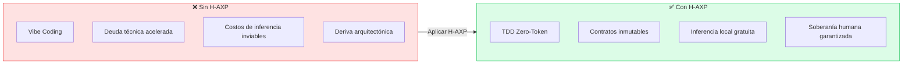
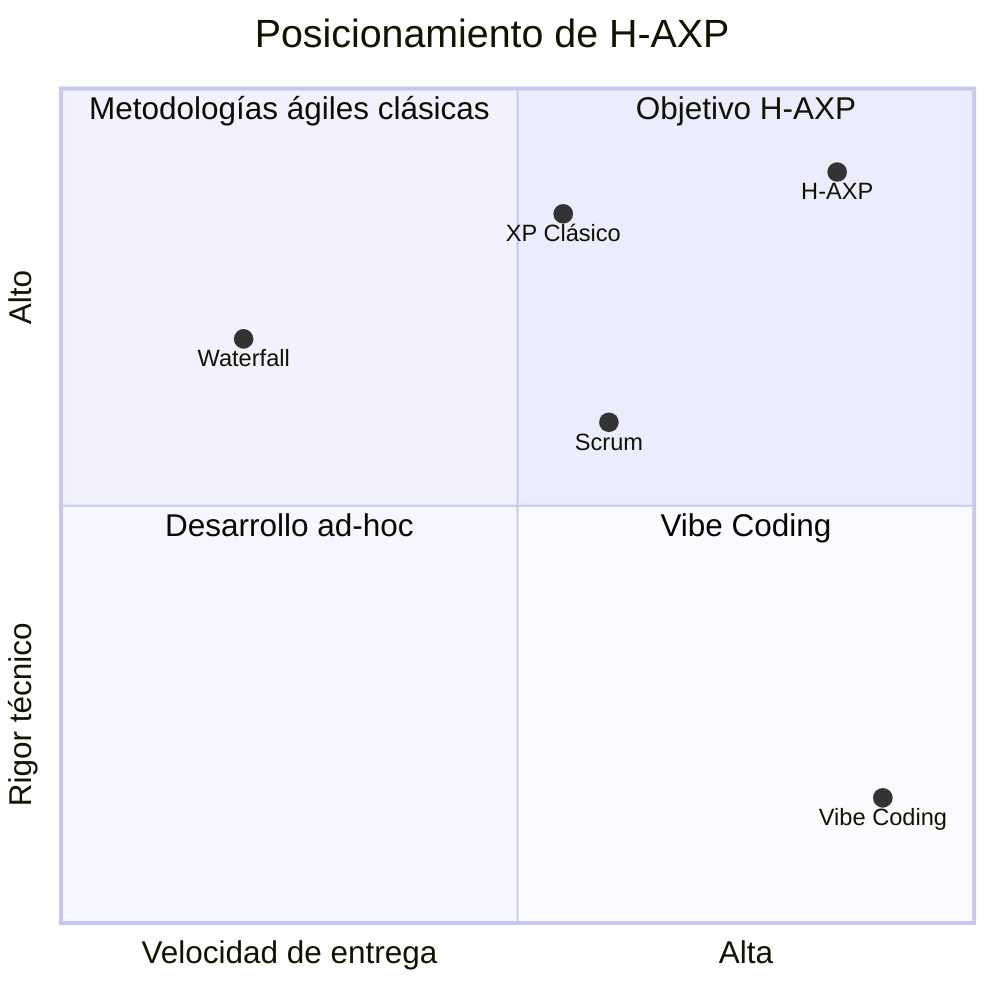
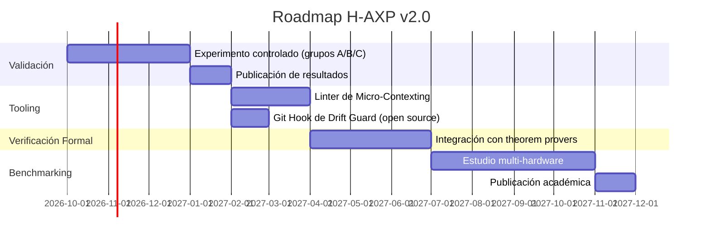

# 🏁 Conclusiones y Trabajo Futuro

---

## Conclusiones

La metodología **Hybrid-Agentic Extreme Programming (H-AXP)** demuestra que el potencial de la inteligencia artificial generativa en ingeniería de software **no reside en la sustitución de las prácticas disciplinadas, sino en su intensificación**.

Al transformar Extreme Programming y Scrum en un marco estructurado por Nodos Simbióticos de H-AXP gobernados por contratos inmutables y ejecución *Zero-Token*, se establece un estándar reproducible y resiliente para la industria tecnológica.



---

## Aportes Principales

| Aporte | Descripción |
|---|---|
| **Arquitectura de dos capas** | Separación clara entre diseño estratégico (Nube) y ejecución táctica (Local) |
| **TDD Zero-Token** | El ciclo Red-Green-Refactor se ejecuta íntegramente en hardware local, sin costo de API |
| **Micro-Contexting** | Segregación estricta de la carga cognitiva entre agentes mediante System Prompts deterministas |
| **H-AXP Risk Matrix** | Protocolo formal de mitigación de degradación estocástica en agentes de IA |
| **Nodos Simbióticos** | Extensión del Pair Programming de XP a binomios Humano-IA en todas las capas |

---

## H-AXP resuelve la tensión entre velocidad y rigor

H-AXP resuelve la tensión entre velocidad de entrega y rigor técnico, permitiendo que equipos de desarrollo mantengan un alto rendimiento sin comprometer la integridad arquitectónica de sus sistemas.



---

## Líneas de Trabajo Futuro

### 1. 🔧 Automatización de Linters de Micro-Contexting
Desarrollo de herramientas de análisis estático que midan y purguen automáticamente la KV Cache antes de cada compilación local. Esto permitiría eliminar la intervención manual en el paso de *State Wiping*.

### 2. 🔬 Protocolos de Verificación Formal en Nube
Integración de demostradores de teoremas para validar formalmente que las suites de TDD generadas por el modelo de nube son semánticamente completas antes de ser inyectadas en la capa táctica.

### 3. 📊 Benchmarking Empírico Multi-Hardware
Publicación de estudios de campo comparando la ejecución de H-AXP a través de diversas configuraciones de hardware y stacks tecnológicos empresariales, con métricas reales de DD, CMR, LTPR, TCF y M.

---

## Roadmap Tentativo



---

## Cita Sugerida

```
Guzmán, B. (2026). Hybrid-Agentic eXtreme Programming (H-AXP):
Un marco de desarrollo de software híbrido y simbiótico para
equipos Humano-IA. Asunción, Paraguay. Elaboración propia.
```

---

← [Anterior: Ética y Propiedad Intelectual](09-etica-propiedad-intelectual.md) | [Volver al README](../README.md)
