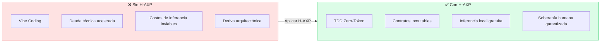
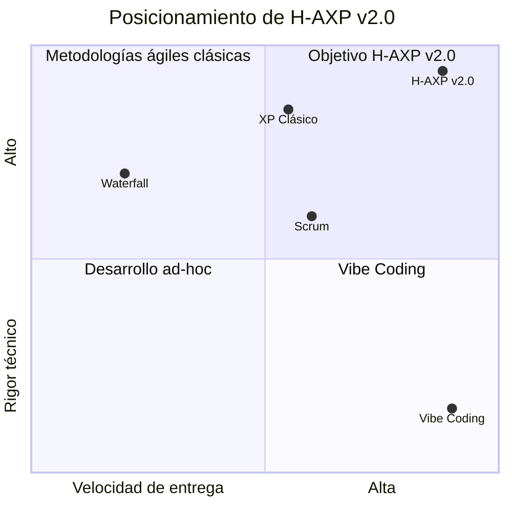
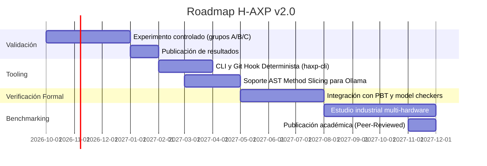

# 🏁 Conclusiones y Trabajo Futuro

---

## Conclusiones

La metodología **Hybrid-Agentic Extreme Programming (H-AXP)** demuestra que el potencial de la inteligencia artificial generativa en ingeniería de software **no reside en la sustitución de las prácticas disciplinadas, sino en su intensificación**.

Al transformar Extreme Programming y Scrum en un marco estructurado por Nodos Simbióticos de H-AXP gobernados por contratos inmutables y ejecución *Zero-Token*, se establece un estándar reproducible y resiliente para la industria tecnológica.

---

## Aportes Principales (v2.0)

| Aporte | Descripción |
|---|---|
| **Arquitectura de dos capas y Trunk-Based** | Separación formal entre diseño estratégico (Nube) y ejecución táctica (Local) gobernada por Commit 0 inmutable |
| **TDD Zero-Token & Doble Anillo** | Ciclo Red-Green con Stubs Canónicos, Property-Based Testing (PBT) y suites sombra anti-sobreajuste |
| **Micro-Contexting y AST Slicing** | Segregación estricta de prompts deterministas y aislamiento por métodos para modelos de 3B |
| **Protocolo CEP y Fallbacks** | Escalado formal de contratos bloqueantes mediante `<Contract_Fault_Ticket>` y purgado markoviano |
| **Ofuscación Ontológica** | Mapeo isomórfico de historias de usuario a dominios abstractos para proteger secretos industriales |
| **Marco Métrico Integral** | Métricas formales de balance empírico: $TCF_{total}$, $CMR = 0\%$, $HATR \le 25\%$, $MS \ge 85\%$, $\mathcal{M} \le 10$ y $\mathcal{C}_{cog} \le 12$ |

---

## H-AXP resuelve la tensión entre velocidad y rigor

H-AXP resuelve la tensión entre velocidad de entrega y rigor técnico, permitiendo que equipos de desarrollo mantengan un alto rendimiento sin comprometer la integridad arquitectónica de sus sistemas ni incurrir en costos de inferencia inviables.

---

## Líneas de Trabajo Futuro

### 1. 🔧 Automatización de Linters y Git Hooks Deterministas
Implementación y empaquetado del guardián de *pre-commit* y herramientas CLI (`haxp-cli`) que auditen firmas SHA-256 de contratos, ejecuten suites sombra de forma desatendida y monitoreen la ocupación de KV Cache.

### 2. 🔬 Protocolos de Verificación Formal en Nube
Integración de asistentes de demostración formal y model checkers para validar que los esquemas DDL y las suites de pruebas cubran exhaustivamente el espacio de estados antes de bajar a la Capa Local.

### 3. 📊 Benchmarking Empírico Multi-Hardware
Publicación de estudios de campo comparando la ejecución de H-AXP a través de diversas configuraciones de hardware y stacks tecnológicos empresariales, con métricas reales de $DD$, $CMR$, $LTPR$, $TCF_{total}$, $HATR$ y $MS$.

---

## Roadmap Tentativo

---

← [Anterior: Ética y Propiedad Intelectual](09-etica-propiedad-intelectual.md) | [Volver al README](../README.md)
